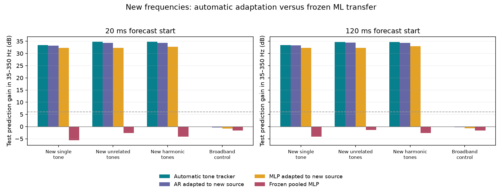

# Automatic adaptation is different from frozen-ML transfer

This small synthetic diagnostic tests new frequencies without giving their labels to the predictors. It does not establish real-world ANC or arbitrary-tone performance.

| Source | Horizon | Validation-selected method | Test band prediction gain | Full-reference NRMSE |
|---|---:|---|---:|---:|
| single_tone | 20 ms | auto_tone_tracker | 33.39 dB | 0.0381 |
| single_tone | 120 ms | auto_tone_tracker | 33.38 dB | 0.0381 |
| unrelated_tones | 20 ms | auto_tone_tracker | 34.83 dB | 0.0320 |
| unrelated_tones | 120 ms | auto_tone_tracker | 34.73 dB | 0.0321 |
| harmonic_tones | 20 ms | auto_tone_tracker | 34.79 dB | 0.0323 |
| harmonic_tones | 120 ms | auto_tone_tracker | 34.69 dB | 0.0323 |
| broadband_negative_control | 20 ms | zero | 0.00 dB | 1.0000 |
| broadband_negative_control | 120 ms | zero | 0.00 dB | 1.0000 |

The automatic tracker detects up to three peaks from the new source prefix. Adapted AR and MLP models train on that prefix. The frozen pooled MLP has weights trained on three other source groups; only input scaling uses the new prefix. These are different adaptation budgets and are reported separately.

Training / validation / test are chronological 6 / 2 / 4 seconds. The two forecasts cover the next 10 ms starting just after 20 or 120 ms. Validation selection includes zero. Training targets are embargoed from validation and test; pooled windows never cross source boundaries. Settings and frequency groups were saved before training/evaluation.

The MLP is a first 64-unit comparator, not a claim about the limits of ML. Review convergence warnings in generalization.json. There is one seed per source case and no frequency-drift, microphone processing, acoustic path or playback jitter in this diagnostic; the original simulator separately covers assumed delay, jitter and path errors.

A broadly trained model must later be assessed on whole withheld recordings, devices and environments. The same source may not be split into near-duplicate train/test recordings to claim transfer.
