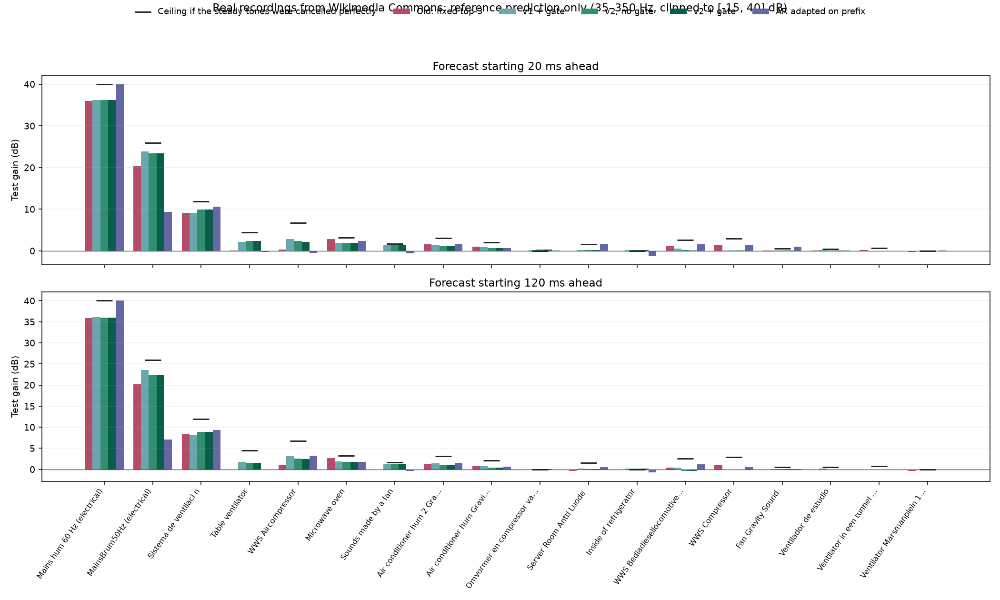

# Real hums recorded by other people: how predictable are they?

**Reference-signal prediction on independent real recordings.** No acoustic path, no playback, no ear measurement. A forecast gain here says how well the hum *at the recording microphone* could be predicted ahead of time. It is not noise cancellation.

Settings: v1 and v2 frozen from `release_protocol.json`, unchanged. Nothing was tuned on these files. Split: normalize and fit prefix-trained comparators on the first 40%; score the remaining 60%. Recordings longer than 180 s were cut there.

## Summary (computed from the tables below)

- Analysed: 16 acoustic recordings and 2 electrical mains-hum clips; 1 file(s) could not be decoded (listed below).
- Whole 35–350 Hz band, 20 ms ahead, acoustic recordings: v2 + gate median 0.3 dB; at least 3 dB on 1 of 16. Median ceiling for a perfect tones-only canceller: 1.9 dB.
- Below −0.5 dB (worse than predicting nothing) at either horizon: v2 + gate on 0 file(s); AR adapted on prefix on 3.
- Tone bins alone (±1.5 Hz around the reference tones), 20 ms ahead, on the 13 acoustic recordings that have tones: v2 + gate median 2.9 dB, AR median 6.3 dB. AR was more than 3 dB better on 8, v2 more than 3 dB better on 3.

"Reference tones" come from a separate, after-the-fact spectral analysis of each test part (peaks at least 10 dB above the surrounding ±10 Hz). No forecaster sees them; they only say where to measure. "Tone share" = share of the test part's 35–350 Hz power within ±1.5 Hz of them. "Ceiling" = −10·log10(1 − share): what perfect cancellation of only those tones would remove from the band.

## Whole band, 35–350 Hz (test part; dB, 20 / 120 ms ahead)

| Recording | Kind | Test s | Reference tones (Hz) | Tone share | Ceiling | Old: fixed top-3 | v1 + gate | v2, no gate | v2 + gate | AR adapted on prefix |
|---|---|---:|---|---:|---:|---:|---:|---:|---:|---:|
| [Mains hum 60 Hz](https://commons.wikimedia.org/wiki/File:Mains_hum_60_Hz.ogg) | electrical | 3 | 60, 119, 180, 240, 300, 315 | 100% | 48.6 | 36.0 / 35.9 | 36.2 / 36.1 | 36.2 / 36.0 | 36.2 / 36.0 | 42.8 / 42.3 |
| [MainsBrum50Hz](https://commons.wikimedia.org/wiki/File:MainsBrum50Hz.ogg) | electrical | 3 | 50, 100, 150, 200, 250, 350 | 100% | 26.0 | 20.3 / 20.2 | 23.8 / 23.6 | 23.4 / 22.5 | 23.4 / 22.5 | 9.4 / 7.0 |
| [Sistema de ventilaci n](https://commons.wikimedia.org/wiki/File:Sistema_de_ventilaci%C3%B3n.ogg) | acoustic | 23 | 82, 106, 120, 162, 173, 240 | 94% | 11.9 | 9.1 / 8.3 | 9.1 / 8.2 | 9.9 / 8.9 | 9.9 / 8.9 | 10.6 / 9.3 |
| [Table ventilator](https://commons.wikimedia.org/wiki/File:Table_ventilator.ogg) | acoustic | 26 | 59, 67, 100, 119, 134, 202 | 64% | 4.5 | 0.1 / -0.1 | 2.2 / 1.7 | 2.3 / 1.5 | 2.4 / 1.5 | -0.2 / -0.0 |
| [WWS Aircompressor](https://commons.wikimedia.org/wiki/File:WWS_Aircompressor.ogg) | acoustic | 37 | 161, 169, 177, 185, 194, 225 | 79% | 6.7 | 0.3 / 1.1 | 2.8 / 3.1 | 2.4 / 2.5 | 2.2 / 2.4 | -0.5 / 3.3 |
| [Microwave oven](https://commons.wikimedia.org/wiki/File:Microwave_oven.ogg) | acoustic | 26 | 100, 173, 200, 300, 350 | 52% | 3.2 | 2.8 / 2.7 | 1.9 / 1.9 | 1.9 / 1.7 | 1.9 / 1.8 | 2.4 / 1.8 |
| [Sounds made by a fan](https://commons.wikimedia.org/wiki/File:Sounds_made_by_a_fan.wav) | acoustic | 33 | 83, 165, 331 | 32% | 1.7 | -0.2 / -0.1 | 1.4 / 1.3 | 1.4 / 1.3 | 1.4 / 1.3 | -0.5 / -0.3 |
| [Air conditioner hum 2 Gravity Sou…](https://commons.wikimedia.org/wiki/File:Air_conditioner_hum_2_(Gravity_Sound).wav) | acoustic | 11 | 55, 164, 178, 219, 274, 328 | 51% | 3.1 | 1.5 / 1.3 | 1.5 / 1.4 | 1.3 / 1.0 | 1.3 / 1.0 | 1.7 / 1.6 |
| [Air conditioner hum Gravity Sound ](https://commons.wikimedia.org/wiki/File:Air_conditioner_hum_(Gravity_Sound).wav) | acoustic | 8 | 55, 110, 164, 219, 274, 328 | 38% | 2.1 | 1.0 / 0.9 | 0.8 / 0.8 | 0.6 / 0.4 | 0.6 / 0.4 | 0.7 / 0.6 |
| [Omvormer en compressor van een tr…](https://commons.wikimedia.org/wiki/File:Omvormer_en_compressor_van_een_tram_-_SoundCloud_-_Beeld_en_Geluid.ogg) | acoustic | 67 | none | 0% | -0.0 | 0.0 / -0.2 | 0.2 / -0.2 | 0.4 / 0.1 | 0.4 / 0.1 | 0.0 / -0.1 |
| [Server Room Antti Luode ](https://commons.wikimedia.org/wiki/File:Server_Room_(Antti_Luode).mp3) | acoustic | 102 | 52, 147, 220, 247, 294, 330 | 30% | 1.6 | -0.1 / -0.4 | 0.2 / 0.1 | 0.2 / 0.1 | 0.2 / 0.1 | 1.7 / 0.6 |
| [Inside of refrigerator](https://commons.wikimedia.org/wiki/File:Inside_of_refrigerator.ogg) | acoustic | 13 | none | 0% | -0.0 | -0.1 / -0.2 | 0.2 / 0.2 | 0.2 / 0.1 | 0.2 / 0.1 | -1.3 / -0.8 |
| [WWS Bediadiesellocomotiveidling](https://commons.wikimedia.org/wiki/File:WWS_Bediadiesellocomotiveidling.ogg) | acoustic | 37 | 51, 56, 61, 86, 91, 132 | 45% | 2.6 | 1.1 / 0.3 | 0.5 / 0.4 | 0.2 / -0.4 | 0.1 / -0.4 | 1.6 / 1.2 |
| [WWS Compressor](https://commons.wikimedia.org/wiki/File:WWS_Compressor.ogg) | acoustic | 75 | 36, 54, 63, 72, 81, 90 | 49% | 2.9 | 1.4 / 0.9 | 0.1 / 0.0 | 0.1 / -0.1 | 0.1 / -0.1 | 1.5 / 0.5 |
| [Fan Gravity Sound ](https://commons.wikimedia.org/wiki/File:Fan_(Gravity_Sound).wav) | acoustic | 20 | 42, 120 | 12% | 0.5 | 0.1 / -0.2 | 0.1 / 0.1 | 0.1 / 0.0 | 0.1 / 0.0 | 1.0 / 0.1 |
| [Ventilador de estudio](https://commons.wikimedia.org/wiki/File:Ventilador_de_estudio.ogg) | acoustic | 9 | 38, 113, 120, 226 | 10% | 0.5 | 0.1 / -0.2 | 0.2 / 0.2 | 0.0 / -0.0 | 0.0 / 0.0 | 0.0 / -0.1 |
| [Ventilator in een tunnel - SoundC…](https://commons.wikimedia.org/wiki/File:Ventilator_in_een_tunnel_-_SoundCloud_-_Beeld_en_Geluid.ogg) | acoustic | 29 | 43, 57, 64, 97, 129, 244 | 15% | 0.7 | 0.2 / -0.1 | 0.0 / -0.0 | 0.0 / -0.0 | 0.0 / -0.0 | 0.0 / -0.1 |
| [Ventilator Marsmanplein 120919 05…](https://commons.wikimedia.org/wiki/File:Ventilator_Marsmanplein_120919_05_-_SoundCloud_-_the_riel_thing.ogg) | acoustic | 42 | none | 0% | -0.0 | -0.3 / -0.4 | 0.0 / 0.0 | 0.0 / 0.0 | 0.0 / 0.0 | 0.1 / -0.0 |

## Tone bins only (±1.5 Hz around the reference tones; dB, 20 / 120 ms ahead)

How much quieter the tones themselves would be if the forecast were subtracted perfectly at the microphone. This is the part people hear as "hum".

| Recording | Steady tones v2 held (Hz) | Old: fixed top-3 | v1 + gate | v2, no gate | v2 + gate | AR adapted on prefix |
|---|---|---:|---:|---:|---:|---:|
| Mains hum 60 Hz | 60, 180, 240, 300, 315 | 46.2 / 45.7 | 50.0 / 48.2 | 51.8 / 49.7 | 51.8 / 49.7 | 45.1 / 44.4 |
| MainsBrum50Hz | 50, 100, 150, 200, 250, 300 | 22.1 / 22.0 | 29.5 / 28.7 | 29.0 / 27.9 | 29.0 / 27.9 | 9.6 / 7.2 |
| Sistema de ventilaci n | 120 | 12.0 / 10.4 | 11.9 / 10.2 | 14.8 / 12.1 | 14.8 / 12.1 | 19.0 / 15.3 |
| Table ventilator | 100 | 0.4 / 0.2 | 5.1 / 3.9 | 6.1 / 4.5 | 6.1 / 4.5 | 0.3 / 0.4 |
| WWS Aircompressor | 169, 161 | 0.3 / 1.5 | 3.5 / 4.0 | 3.2 / 3.4 | 2.9 / 3.4 | -0.5 / 4.5 |
| Microwave oven | none | 8.4 / 7.3 | 3.7 / 3.6 | 3.7 / 3.7 | 3.7 / 3.7 | 15.5 / 11.2 |
| Sounds made by a fan | none | -0.2 / 0.1 | 7.2 / 6.2 | 7.8 / 6.9 | 7.8 / 6.9 | -0.7 / -0.1 |
| Air conditioner hum 2 Gravity Sou… | 274, 55 | 5.3 / 4.2 | 4.1 / 3.7 | 4.4 / 3.9 | 4.4 / 3.9 | 7.6 / 7.2 |
| Air conditioner hum Gravity Sound  | 274, 55, 219 | 6.2 / 4.9 | 5.0 / 4.3 | 5.2 / 4.1 | 5.2 / 4.1 | 9.1 / 7.3 |
| Server Room Antti Luode  | 294 | 0.7 / 0.1 | 1.0 / 0.6 | 1.2 / 0.8 | 1.2 / 0.8 | 6.7 / 2.3 |
| WWS Bediadiesellocomotiveidling | 61, 51, 46, 56, 41 | 3.9 / 1.5 | 1.4 / 0.9 | 1.7 / 0.5 | 1.7 / 0.5 | 6.3 / 4.1 |
| WWS Compressor | none | 3.7 / 2.7 | 0.2 / 0.1 | 0.3 / -0.0 | 0.3 / -0.0 | 3.0 / 2.2 |
| Fan Gravity Sound  | 120 | 3.4 / 0.6 | 0.5 / 0.5 | 0.5 / 0.5 | 0.5 / 0.5 | 13.1 / 3.8 |
| Ventilador de estudio | 120, 113 | 3.0 / 2.8 | 2.6 / 2.5 | 2.3 / 2.4 | 2.3 / 2.4 | 2.7 / 3.6 |
| Ventilator in een tunnel - SoundC… | none | 3.0 / 1.0 | 0.3 / 0.1 | 0.5 / 0.3 | 0.5 / 0.3 | 3.7 / 1.9 |

"Steady tones v2 held" = tones the v2 detector kept active in at least half of its test-part updates.

## Detector behaviour (test part)

| Recording | v2 mean active tones | v2 updates with any tone | v2 gate open (20 / 120 ms) | v1 mean active tones | Channels (used) |
|---|---:|---:|---:|---:|---|
| Mains hum 60 Hz | 4.82 | 100% | 100% / 100% | 4.82 | 1 (ch 0) |
| MainsBrum50Hz | 6.00 | 100% | 100% / 100% | 6.00 | 1 (ch 0) |
| Sistema de ventilaci n | 2.16 | 100% | 100% / 100% | 2.16 | 2 (ch 0, L/R corr 0.97) |
| Table ventilator | 2.01 | 80% | 97% / 97% | 2.01 | 2 (ch 0, L/R corr 0.45) |
| WWS Aircompressor | 6.00 | 100% | 95% / 95% | 6.00 | 2 (ch 0, L/R corr 0.87) |
| Microwave oven | 1.83 | 43% | 98% / 98% | 1.83 | 2 (ch 0, L/R corr 0.78) |
| Sounds made by a fan | 2.33 | 45% | 98% / 98% | 2.33 | 2 (ch 0, L/R corr 1.00) |
| Air conditioner hum 2 Gravity Sou… | 3.56 | 100% | 100% / 100% | 3.56 | 2 (ch 0, L/R corr 1.00) |
| Air conditioner hum Gravity Sound  | 3.15 | 100% | 100% / 100% | 3.15 | 2 (ch 0, L/R corr 1.00) |
| Omvormer en compressor van een tr… | 1.18 | 46% | 100% / 100% | 1.18 | 2 (ch 0, L/R corr 0.74) |
| Server Room Antti Luode  | 1.98 | 80% | 100% / 100% | 1.98 | 2 (ch 0, L/R corr 0.89) |
| Inside of refrigerator | 3.18 | 88% | 97% / 97% | 3.18 | 2 (ch 0, L/R corr 0.50) |
| WWS Bediadiesellocomotiveidling | 5.82 | 100% | 92% / 92% | 5.82 | 1 (ch 0) |
| WWS Compressor | 0.22 | 20% | 100% / 100% | 0.22 | 2 (ch 0, L/R corr 0.24) |
| Fan Gravity Sound  | 1.00 | 100% | 99% / 99% | 1.00 | 2 (ch 0, L/R corr 1.00) |
| Ventilador de estudio | 1.81 | 100% | 100% / 100% | 1.81 | 2 (ch 0, L/R corr 0.23) |
| Ventilator in een tunnel - SoundC… | 0.75 | 60% | 100% / 100% | 0.75 | 2 (ch 0, L/R corr 1.00) |
| Ventilator Marsmanplein 120919 05… | 0.00 | 0% | 100% / 100% | 0.00 | 2 (ch 0, L/R corr 1.00) |

## Not analysed

- Resident air-conditioned out door unit: the local decoder (libsndfile) could not read it (LibsndfileError: Supported file format but file is malformed.). It is kept unchanged on disk.

## Sources and licences

All files are from Wikimedia Commons and were downloaded with the user's approval for local analysis only. They are not redistributed. SHA-256 for each file is in `real_hums.json`. Full records: `external-audio/wikimedia-commons-2026-10-16/SOURCES.md`.

| Recording | Licence | Author |
|---|---|---|
| Air conditioner hum 2 Gravity Sound  | CC BY 4.0 | Gravity Sound |
| Air conditioner hum Gravity Sound  | CC BY 4.0 | Gravity Sound |
| Fan Gravity Sound  | CC BY 4.0 | Gravity Sound |
| Inside of refrigerator | Public domain | stephan |
| MainsBrum50Hz | Public domain | No machine-readable author provided. Julo assumed (based on copyright  |
| Mains hum 60 Hz | CC BY-SA 3.0 | — |
| Microwave oven | Public domain | stephan |
| Omvormer en compressor van een tram - SoundCloud - Beeld en… | CC BY-SA 3.0 | Beeld en Geluid |
| Resident air-conditioned out door unit | CC0 | Ranch9613 |
| Server Room Antti Luode  | CC BY 3.0 | Antti Luode |
| Sistema de ventilaci n | CC BY-SA 4.0 | Marhesky |
| Sounds made by a fan | CC BY-SA 3.0 | Doggo19292 |
| Table ventilator | Public domain | stephan |
| Ventilador de estudio | CC BY-SA 4.0 | Hippocampuz |
| Ventilator Marsmanplein 120919 05 - SoundCloud - the riel t… | CC BY-SA 3.0 | the_riel_thing |
| Ventilator in een tunnel - SoundCloud - Beeld en Geluid | CC BY-SA 3.0 | Beeld en Geluid |
| WWS Aircompressor | CC BY 4.0 | Work With Sounds / Torsten Nilsson |
| WWS Bediadiesellocomotiveidling | CC BY 4.0 | Work With Sounds / Technical Museum of Slovenia |
| WWS Compressor | CC BY 4.0 | Work With Sounds / Torsten Nilsson |

## Honest limits

- Unknown microphones, rooms, gain and editing. Most files are lossy-compressed (Ogg Vorbis, MP3). Some may have been trimmed, filtered or noise-reduced before upload.
- Stereo files: channel 0 only, never averaged (the correlation between channels is listed above).
- One recording per source and no repeats. The 60% test part is late in each file, so a source that changes later (switching on or off, speed steps) is in the test part.
- The two mains-hum clips are electrical pickups of 5–6 s, not sound in air. They show the detector on an almost perfectly periodic signal and are reported separately.
- A high forecast gain at the microphone is necessary for cancellation at the ear but not sufficient. The ear hears the hum through a different path, and the earphone adds its own.

## Compute

- v2 selector update 6.6 ms mean; forecast 1.28 ms per 10 ms block (offline Python, one thread).
- Whole check: 1.0 minutes.
