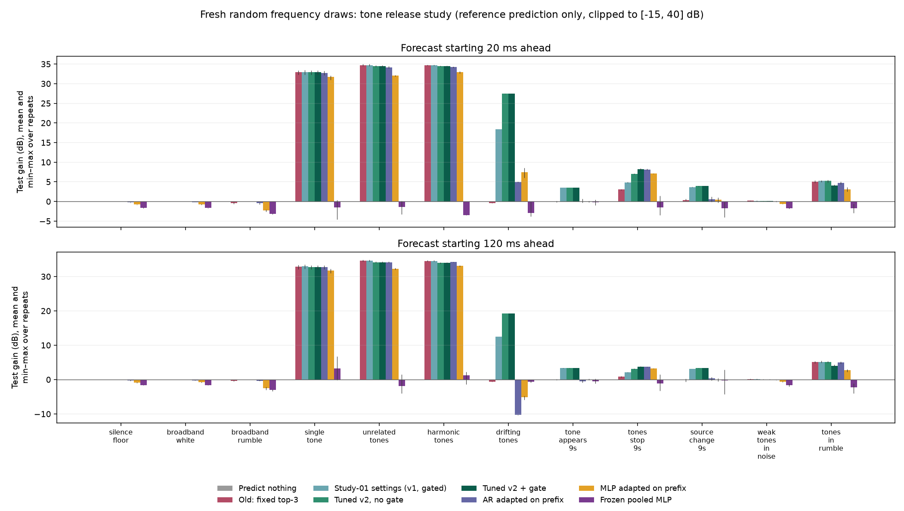

# Faster tone release, tuned on development only, with repeats

Synthetic **reference-signal prediction** only. No acoustic path, playback or ear measurement. Not evidence of real-world noise cancellation.

Every test number is over 5 independent random frequency draws (each a full set of 12 scenes, new seeds). Bars are the mean; whiskers are the lowest and highest repeat.

## What was tuned, and on what

- Development only: 3 frequency draws × 12 scenes. Test draws were generated after the settings below were written to `release_protocol.json`.
- Objective: Mean over development scenes of the mean band gain (capped at 20 dB) over the 2.5-11.8 s window and each 1.5 s post-onset/offset window, both horizons. Stage A (selector release, fast amplitude release, tracker window) without gate; then stage B (gate) on the stage-A winner. Ties (objective equal to 0.001 dB): longer tracker window, then larger selector release, i.e. the setting closer to v1. Stage B ties prefer no gate.
- v1 (study-01 settings, unchanged): release after 4 misses, tracker window 0.6 s, no fast release, gate −1 dB over 25 blocks. Development objective 7.35.
- **v2 (tuned):** release after 4 misses, tracker window 0.3 s, fast release drop a tone when its last 0.1 s amplitude falls below 0.5× its 0.3 s amplitude; gate: mute unless the last 5 matured blocks beat zero by -1 dB (shared, driven by the 20 ms horizon). Development objective 7.90.

### Stage A on development (no gate), best 8

| Release misses | Fast-release ratio | Short window (s) | Tracker window (s) | Dev objective | Worst dev scene |
|---:|---:|---:|---:|---:|---:|
| 4 | 0.5 | 0.1 | 0.3 | 7.86 | -0.02 |
| 2 | 0.5 | 0.1 | 0.3 | 7.86 | -0.01 |
| 1 | 0.5 | 0.1 | 0.3 | 7.86 | -0.01 |
| 4 | 0.3 | 0.1 | 0.3 | 7.83 | -0.02 |
| 2 | 0.3 | 0.1 | 0.3 | 7.83 | -0.01 |
| 1 | 0.3 | 0.1 | 0.3 | 7.83 | -0.01 |
| 4 | 0.5 | 0.2 | 0.3 | 7.74 | -0.02 |
| 2 | 0.5 | 0.2 | 0.3 | 7.74 | -0.01 |

### Stage B on development (gate on the stage-A winner)

| Gate threshold (dB) | Lookback blocks | Shared | Dev objective | Worst dev scene |
|---:|---:|---|---:|---:|
| -1 | 5 | yes | 7.90 | -0.02 |
| -1 | 5 | no | 7.89 | -0.02 |
| none | — | no | 7.86 | -0.02 |
| 0 | 5 | yes | 7.85 | -0.01 |
| -1 | 25 | yes | 7.84 | -0.02 |
| 0 | 5 | no | 7.84 | -0.01 |
| -1 | 25 | no | 7.82 | -0.02 |
| -1 | 10 | yes | 7.79 | -0.02 |
| 1 | 5 | yes | 7.78 | 0.00 |
| -1 | 10 | no | 7.78 | -0.02 |
| 1 | 5 | no | 7.75 | 0.00 |
| 0 | 25 | yes | 7.75 | -0.00 |
| 0 | 10 | yes | 7.73 | -0.00 |
| 0 | 10 | no | 7.73 | -0.01 |
| 0 | 25 | no | 7.72 | -0.00 |
| 3 | 5 | yes | 7.69 | 0.00 |
| 3 | 5 | no | 7.66 | 0.00 |
| 1 | 10 | yes | 7.65 | 0.00 |
| 1 | 10 | no | 7.62 | 0.00 |
| 3 | 10 | yes | 7.59 | 0.00 |
| 3 | 10 | no | 7.56 | 0.00 |
| 1 | 25 | yes | 7.54 | 0.00 |
| 1 | 25 | no | 7.52 | 0.00 |
| 3 | 25 | yes | 7.41 | 0.00 |
| 3 | 25 | no | 7.38 | 0.00 |

## Test prediction gain over repeats, 35–350 Hz (dB; mean [min, max])

| Scene | Horizon | Old: fixed top-3 | Study-01 settings (v1, gated) | Tuned v2, no gate | Tuned v2 + gate | AR adapted on prefix | MLP adapted on prefix | Frozen pooled MLP |
|---|---:|---:|---:|---:|---:|---:|---:|---:|
| silence_floor | 20 ms | -0.1 [-0.1, -0.1] | -0.0 [-0.0, 0.0] | -0.0 [-0.0, 0.0] | -0.0 [-0.0, 0.0] | -0.3 [-0.3, -0.2] | -0.8 [-0.9, -0.7] | -1.7 [-1.8, -1.5] |
| silence_floor | 120 ms | -0.1 [-0.1, -0.1] | -0.0 [-0.0, 0.0] | -0.0 [-0.0, 0.0] | -0.0 [-0.0, 0.0] | -0.3 [-0.4, -0.2] | -0.8 [-1.0, -0.7] | -1.6 [-1.7, -1.5] |
| broadband_white | 20 ms | -0.1 [-0.1, -0.1] | 0.0 [0.0, 0.0] | 0.0 [0.0, 0.0] | 0.0 [0.0, 0.0] | -0.2 [-0.3, -0.2] | -0.8 [-0.8, -0.7] | -1.7 [-1.7, -1.6] |
| broadband_white | 120 ms | -0.1 [-0.1, -0.1] | 0.0 [0.0, 0.0] | 0.0 [0.0, 0.0] | 0.0 [0.0, 0.0] | -0.2 [-0.3, -0.1] | -0.8 [-0.9, -0.7] | -1.6 [-1.6, -1.5] |
| broadband_rumble | 20 ms | -0.4 [-0.6, -0.3] | 0.0 [0.0, 0.0] | 0.0 [0.0, 0.0] | 0.0 [0.0, 0.0] | -0.5 [-0.8, -0.3] | -2.3 [-2.6, -2.0] | -3.2 [-3.3, -3.1] |
| broadband_rumble | 120 ms | -0.4 [-0.5, -0.2] | 0.0 [0.0, 0.0] | 0.0 [0.0, 0.0] | 0.0 [0.0, 0.0] | -0.3 [-0.4, -0.2] | -2.5 [-3.0, -2.1] | -3.1 [-3.4, -2.9] |
| single_tone | 20 ms | 32.9 [32.2, 33.4] | 33.0 [32.3, 33.4] | 32.9 [32.2, 33.3] | 32.9 [32.2, 33.3] | 32.8 [32.2, 33.2] | 31.8 [31.0, 32.1] | -1.6 [-4.6, 0.4] |
| single_tone | 120 ms | 32.9 [32.2, 33.3] | 32.9 [32.2, 33.4] | 32.8 [32.1, 33.2] | 32.8 [32.1, 33.2] | 32.8 [32.1, 33.2] | 31.8 [31.0, 32.3] | 3.2 [-0.1, 6.7] |
| unrelated_tones | 20 ms | 34.6 [34.4, 35.0] | 34.6 [34.4, 35.0] | 34.4 [34.3, 34.7] | 34.4 [34.3, 34.7] | 34.2 [33.9, 34.5] | 32.0 [31.9, 32.2] | -1.4 [-3.3, 0.1] |
| unrelated_tones | 120 ms | 34.6 [34.3, 34.9] | 34.6 [34.3, 34.9] | 34.1 [33.9, 34.4] | 34.1 [33.9, 34.4] | 34.2 [34.0, 34.3] | 32.2 [32.0, 32.5] | -1.9 [-4.1, 1.5] |
| harmonic_tones | 20 ms | 34.6 [34.5, 34.8] | 34.6 [34.5, 34.8] | 34.4 [34.3, 34.6] | 34.4 [34.3, 34.6] | 34.2 [34.0, 34.4] | 32.9 [32.6, 33.2] | -3.4 [-3.5, -3.4] |
| harmonic_tones | 120 ms | 34.5 [34.4, 34.7] | 34.5 [34.4, 34.7] | 34.0 [33.8, 34.2] | 34.0 [33.8, 34.2] | 34.2 [34.1, 34.3] | 33.1 [32.9, 33.2] | 1.3 [-1.4, 2.2] |
| drifting_tones | 20 ms | -0.4 [-0.4, -0.4] | 18.4 [18.4, 18.4] | 27.4 [27.4, 27.4] | 27.4 [27.4, 27.4] | 4.9 [4.8, 5.0] | 7.4 [6.0, 8.5] | -3.0 [-3.8, -0.1] |
| drifting_tones | 120 ms | -0.6 [-0.7, -0.5] | 12.5 [12.5, 12.5] | 19.2 [19.2, 19.2] | 19.2 [19.2, 19.2] | -10.2 [-10.3, -10.2] | -5.1 [-5.9, -4.7] | -0.7 [-0.9, -0.3] |
| tone_appears_9s | 20 ms | -0.1 [-0.2, 0.1] | 3.5 [3.5, 3.5] | 3.5 [3.5, 3.5] | 3.5 [3.5, 3.5] | -0.0 [-0.3, 0.6] | -0.0 [-0.2, 0.2] | -0.2 [-0.9, 0.5] |
| tone_appears_9s | 120 ms | -0.0 [-0.1, 0.1] | 3.3 [3.3, 3.3] | 3.3 [3.3, 3.3] | 3.3 [3.3, 3.3] | -0.5 [-0.8, -0.1] | -0.0 [-0.1, 0.2] | -0.5 [-1.1, 0.2] |
| tones_stop_9s | 20 ms | 3.0 [2.9, 3.1] | 4.8 [4.7, 4.9] | 7.0 [6.9, 7.1] | 8.2 [8.0, 8.5] | 8.1 [8.0, 8.3] | 7.1 [7.0, 7.2] | -1.5 [-3.5, 1.5] |
| tones_stop_9s | 120 ms | 0.8 [0.7, 1.0] | 2.1 [2.0, 2.2] | 3.1 [3.0, 3.3] | 3.7 [3.6, 3.9] | 3.7 [3.6, 3.7] | 3.2 [3.1, 3.3] | -1.2 [-3.3, 1.4] |
| source_change_9s | 20 ms | 0.4 [0.2, 0.7] | 3.7 [3.6, 3.7] | 3.9 [3.8, 3.9] | 4.0 [3.9, 4.0] | 0.5 [-0.0, 1.2] | 0.4 [-0.3, 1.1] | -1.8 [-4.1, -0.2] |
| source_change_9s | 120 ms | -0.1 [-0.7, 0.2] | 3.1 [3.1, 3.2] | 3.3 [3.2, 3.4] | 3.4 [3.3, 3.4] | 0.3 [-0.3, 0.8] | -0.0 [-0.5, 0.4] | -0.3 [-4.2, 2.9] |
| weak_tones_in_noise | 20 ms | 0.2 [0.2, 0.3] | 0.1 [0.1, 0.2] | 0.1 [0.0, 0.1] | 0.1 [0.0, 0.1] | -0.0 [-0.1, 0.1] | -0.6 [-0.7, -0.5] | -1.7 [-1.9, -1.6] |
| weak_tones_in_noise | 120 ms | 0.1 [0.0, 0.2] | 0.1 [0.0, 0.2] | 0.0 [-0.0, 0.1] | 0.0 [-0.0, 0.1] | -0.1 [-0.1, 0.0] | -0.7 [-0.8, -0.5] | -1.6 [-2.0, -1.2] |
| tones_in_rumble | 20 ms | 5.0 [4.7, 5.4] | 5.2 [4.9, 5.4] | 5.2 [4.9, 5.5] | 4.0 [3.8, 4.3] | 4.8 [4.4, 5.0] | 3.1 [2.5, 3.6] | -1.8 [-3.0, -0.6] |
| tones_in_rumble | 120 ms | 5.1 [4.8, 5.4] | 5.1 [4.9, 5.5] | 5.1 [4.9, 5.4] | 4.0 [3.7, 4.3] | 4.9 [4.6, 5.2] | 2.7 [2.3, 2.9] | -2.3 [-4.1, -1.1] |

## Right after a tone starts or stops (forecasts issued in the 1.5 s after each event; mean / worst over repeats and events)

| Scene | Horizon | Old: fixed top-3 | Study-01 settings (v1, gated) | Tuned v2, no gate | Tuned v2 + gate | AR adapted on prefix | MLP adapted on prefix | Frozen pooled MLP |
|---|---:|---:|---:|---:|---:|---:|---:|---:|
| tone_appears_9s | 20 ms | -0.1 / -0.3 | 0.8 / 0.8 | 0.8 / 0.8 | 0.8 / 0.8 | -0.0 / -0.3 | -0.0 / -0.2 | -0.2 / -0.9 |
| tone_appears_9s | 120 ms | -0.0 / -0.1 | 0.8 / 0.8 | 0.8 / 0.8 | 0.8 / 0.8 | -0.5 / -0.9 | -0.0 / -0.1 | -0.5 / -1.1 |
| tones_stop_9s | 20 ms | -12.5 / -13.0 | -10.4 / -10.7 | -7.4 / -8.0 | -5.3 / -6.0 | -5.4 / -5.9 | -6.8 / -7.1 | -4.7 / -5.1 |
| tones_stop_9s | 120 ms | -12.3 / -12.5 | -10.0 / -10.4 | -7.1 / -8.0 | -4.9 / -5.7 | -5.1 / -5.6 | -6.5 / -7.2 | -5.1 / -6.8 |
| source_change_9s | 20 ms | -0.5 / -0.7 | 0.3 / 0.3 | 0.6 / 0.5 | 0.6 / 0.6 | -0.2 / -0.7 | -0.3 / -1.0 | -1.8 / -4.5 |
| source_change_9s | 120 ms | -0.6 / -1.0 | 0.3 / 0.3 | 0.6 / 0.5 | 0.6 / 0.6 | -0.1 / -0.7 | -0.4 / -0.9 | 0.3 / -4.4 |

## Detection and release timing (test window 8–12 s, summed over repeats)

| Scene | v1 false / missed | v2 false / missed | Old top-3 false / missed | v1 output quiet after stop (s) | v2 output quiet after stop (s) |
|---|---:|---:|---:|---:|---:|
| silence_floor | 4 / 0 | 4 / 0 | 240 / 0 | — | — |
| broadband_white | 0 / 0 | 0 / 0 | 240 / 0 | — | — |
| broadband_rumble | 0 / 0 | 0 / 0 | 240 / 0 | — | — |
| single_tone | 0 / 0 | 0 / 0 | 160 / 0 | — | — |
| unrelated_tones | 0 / 0 | 0 / 0 | 0 / 0 | — | — |
| harmonic_tones | 0 / 0 | 0 / 0 | 0 / 0 | — | — |
| drifting_tones | 0 / 0 | 0 / 0 | 204 / 124 | — | — |
| tone_appears_9s | 0 / 20 | 0 / 20 | 240 / 60 | — | — |
| tones_stop_9s | 30 / 0 | 30 / 0 | 200 / 0 | 0.15 (max 0.16) | 0.03 (max 0.03) |
| source_change_9s | 15 / 40 | 15 / 40 | 208 / 108 | — | — |
| weak_tones_in_noise | 0 / 96 | 0 / 96 | 80 / 0 | — | — |
| tones_in_rumble | 0 / 0 | 0 / 0 | 80 / 0 | — | — |

"Output quiet" = seconds after every tone stops until the (gated) forecast RMS stays under 10% of its level in the second before. Only defined for the tones-stop scene.

## Compute (offline Python, one thread per process; not a real-time callback measurement)

- v2 selector update: mean 7.7 ms, max 11.7 ms.
- v2 forecast: mean 0.97 ms per 10 ms block (includes the fast-release amplitude checks).
- Whole study: 2.4 minutes.

## Honest limits

- The release weakness was found on study-01 test scenes, so those are no longer untouched. This study's test draws are new, but the *idea* of improving release came from looking at study-01 test results.
- Scene types are the same twelve as in study 01; only frequencies and noise seeds vary. Repeats measure seed/frequency spread, not coverage of real-world sources.
- Synthetic reference prediction only. No acoustic path, playback timing, microphone processing or ear measurement.
- Frozen pooled MLP: 180 iterations; it is a frozen-weight transfer result, reported separately from per-source adaptation.
