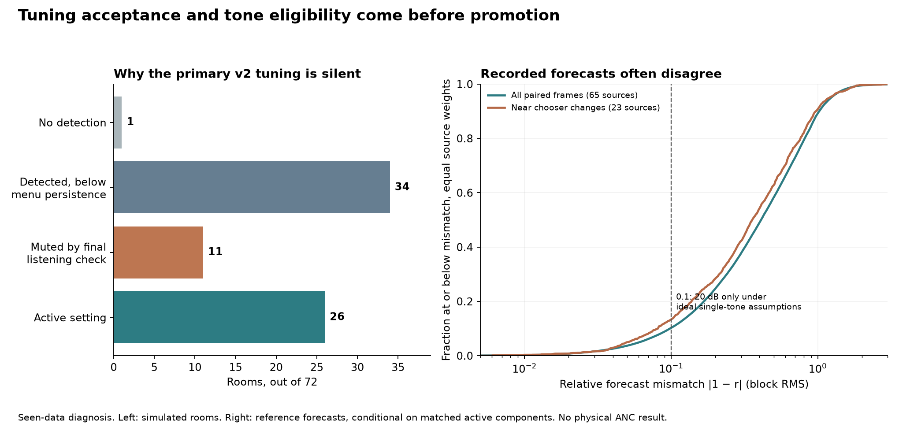

# Compressor, silence and forecast-compatibility diagnosis

24 October 2026. Response to Claude review #53. **The compressor result supports a bad accepted tuning setting; silence is mostly a tone-menu eligibility issue. Predictor interchangeability is not established. Keep v2 live.**

This is a post-hoc diagnostic on existing data, not a new held-out acceptance test. The completed 72-room experiment remains inconclusive with its original harm crossing. No predictor, tuner, guard, menu threshold, live engine or frozen benchmark was changed. The earlier fresh reference-prediction gain also remains unchanged.

## The compressor check supports the tuning explanation

For each of the nine prefix-menu tones in all three compressor rooms, fit the best fixed complex setting separately for v2 and bank output, using only the simulated ear's tuning prefix. These are unconstrained, single-tone least-squares calibration oracles with the native 30 ms renderer, modeled earphone path/delay and an auditory-width band. They use ear information the reference microphone does not provide; they are not a deployable replacement for tuning.

For the harmful room's **193.914 Hz** tone:

| Setting | Gain | Phase |
| --- | --- | --- |
| Best fixed prefix setting for v2 | 0.7823 | 204.27° |
| Best fixed prefix setting for the bank | 0.8094 | 199.90° |
| Actual accepted v2 tuning | 0.6303 | 51.68° |
| Actual accepted chooser tuning | 0.7187 | 200.09° |

The best phases differ by **4.37°**, and the gains by 0.296 dB. The accepted v2 phase is **152.58° away from its own optimum**; the chooser's accepted phase is 0.19° from the bank optimum. The known physical-path phase in this simulation is 203.48°, consistent with this diagnosis. Both two-column fits are well conditioned (about 1.0002), and neither oracle output clips.

Across all nine tone comparisons the largest optimal phase difference is **8.20°**. This supports a poorly accepted v2 setting as the main explanation for this particular case. It does not prove whether judgement noise, changing background sound between sequential presentations, or another tuning interaction caused acceptance. The chooser still changes the bad setting's resulting residual, and the frozen harm crossing is retained.

| Room | Tone Hz | V2 optimum ° | Bank optimum ° | Bank − v2 ° | V2 kept | V2 tuning error ° |
| --- | --- | --- | --- | --- | --- | --- |
| old-013-r0 | 193.86 | 158.89 | 152.50 | -6.39 | no | +31.69 |
| old-013-r0 | 177.83 | 149.49 | 147.62 | -1.87 | no | +57.95 |
| old-013-r0 | 242.48 | 291.04 | 282.84 | -8.20 | yes | -28.77 |
| old-013-r1 | 193.87 | 202.74 | 196.67 | -6.07 | no | +26.03 |
| old-013-r1 | 169.74 | 169.32 | 170.04 | +0.71 | no | -118.59 |
| old-013-r1 | 242.47 | 156.29 | 149.84 | -6.46 | no | -44.79 |
| old-013-r2 | 193.91 | 204.27 | 199.90 | -4.37 | yes | -152.58 |
| old-013-r2 | 177.82 | 167.16 | 166.24 | -0.92 | no | +58.35 |
| old-013-r2 | 169.72 | 173.21 | 172.18 | -1.03 | no | +14.60 |

Fitting uses [1.5 s, prefix end), with two native 0°/90° basis outputs and a second-order causal ERB-width filter. No suffix samples enter the fit. The prefix oracle is signal-aware; it is not merely the exact transfer function at one frequency. Its single-tone auditory-band scores are not interchangeable with the prior all-tone 35–350 Hz or tone-bin outcomes. The complete fits and bounded-output prefix/suffix checks are in [compressor.json](compressor.json).

## Why 46 of 72 rooms have no active v2 setting

| Primary 30 ms outcome | Rooms |
| --- | ---: |
| No v2 tone detected during the eligible prefix | 1 |
| Detections occurred, but no cluster met the tuning-menu persistence rule | 34 |
| Eligible tones existed, but the final on/off listening check muted all of them | 11 |
| At least one accepted active setting | 26 |

Thus **35 rooms had no eligible menu**, not 35 rooms with no detection at all. For the 34 intermittent cases, the strongest cluster occupied a median 18.8% of eligible prefix blocks, range 1.9–48.8%; the menu requires 50%. Merely lowering the threshold would admit less persistent detections and is not justified by this count alone. They may be short useful tones, drift, detector instability or unwanted detections; the audit does not distinguish those causes yet.

All 11 remaining silent primary rooms are explained by the final listening acceptance check. None needed a short-prefix or missing-sweep explanation. There were three gain-limit flags and two one-direction sweep flags among the primary v2 tone summaries; those flags do not themselves mute the output. At 200 ms the split is 1 / 34 / 14 / 23. Chooser-own tuning has the same aggregate room counts, though its individual settings can differ. These are counts of zero settings, not counts of every moment when a positive setting happens to emit nothing due to tracking or gating.

Saved traces independently reproduce the menu membership. Saved flags reproduce the mute reasons. [Room table](muting-rooms.csv) and [tone table](muting-tones.csv) preserve every room/lead/method, including flags. Muting can be the correct response to an unhelpful tone; it is not automatically a defect. Real audibility remains unmeasured.

## Direct comparison across all available seen recordings

The frozen inventory contains **78 decoded recordings, 74.42 minutes**: 71 public acoustic sources, three electrical controls and four personal controls. Six older inventory entries have no retained usable reference array and are disclosed in the protocol; there were no replacements or downloads. The existing normalized references and full retained durations were reused, not the simulated rooms. Synthetic scenes were excluded.

Both predictors consume identical input from sample zero and use the same newest-sample origin. Forecasts are synthesized at the actual **30 ms** lead, using the existing bank's 20 ms decision group. Ratios are evaluated at all 20 samples of each 10 ms output block after a 1.5 s warm-up. Match active components within the native 2 Hz tolerance, sum uniquely associated bank components, and exclude/report ambiguous or missing matches. Both gates must be open and component magnitudes exceed 1e-12. The raw-phasor and separately gate-ramped versions are retained; DC is excluded.

Write r = bank forecast / v2 forecast at the same time, and delta = RMS |1 − r| across the block. These distributions are conditional on a comparable component existing on both sides. A match is an algorithmic association, not proof that both components represent the same physical tone. Values are also reported with v2-amplitude energy weighting so small denominators do not solely determine the conclusion.

| Public acoustic scope | Recordings with pairs | Tone frames | Median source median delta | Median source p95 delta | Mean source fraction delta > 0.1 | Median source median idealized dB |
| --- | --- | --- | --- | --- | --- | --- |
| All after warm-up | 65/71 | 597,201 | 0.428 | 1.230 | 89.7% | 7.36 |
| Original scored suffix | 62/71 | 371,595 | 0.437 | 1.250 | 90.3% | 7.19 |
| Within 100 ms of chooser change | 23/71 | 3,053 | 0.322 | 1.051 | 86.6% | 9.84 |

There are **597,201** matched tone frames across 65 public acoustic recordings. In the remaining six there is no matched active pair, so no ratio claim is made. Across the 65, the median per-source median mismatch is **0.428**; the median per-source 95th percentile is **1.230**. Averaging the within-source proportions equally, **89.7%** of matched frames exceed 0.1. No public source has its 95th-percentile mismatch at or below 0.1. Median source energy-weighted RMS mismatch is **0.544**. These are descriptors of correlated seen-data frames, not independent-trial confidence estimates.

Near actual chooser changes, 23 sources have matched pairs. Their typical median mismatch is still **0.322**, and the equal-source mean fraction above 0.1 is **86.6%**. This comparison includes changes involving zero as well as the two predictors; it is not a measured ear-level jump, and the actual 100 ms blend is not a full instantaneous switch.

Electrical controls are much closer at their typical paired frames (median source median mismatch 0.0174); their tails are still retained. Personal controls remain separate (two of four have matched pairs). Across all 78 recordings, there are 48,742 v2 tone frames without a bank match, 332,963 unmatched bank components, and 110 ambiguous v2 matches, in addition to gate-mismatch frames. Missing counterparts are not assigned a reassuring ratio. Full per-source counts and all three time scopes are in [reference-sources.csv](reference-sources.csv).

## What the ratio does and does not say

For one ideal physical tone s, suppose calibration cancels it perfectly before switching, so the old anti-noise is −s. If the new forecast changes that anti-noise by a common complex factor r while the path and frequency stay compatible, the new residual is (1−r)s. In this special case the retained attenuation is −20 log10 |1−r|: delta = 0.1 corresponds to 20 dB.

With an existing residual e, the new residual is instead **r e + (1−r)s**. Consequently the simple expression is not a general upper bound on ANC or a guaranteed change in cancellation. Real paths, multiple tones, clipping, unmatched components, gating and crossfades also matter. The tabulated idealized medians (about 7.36 dB over all paired public frames) are **not observed or promised ear cancellation**. A large ratio difference does not show which predictor is more accurate; the bank can be correcting a v2 error.

The proposed reassuring premise that mismatch generally stays below 0.1 is not supported. A fixed 0.1 switch guard would be restrictive in this diagnostic, but that is not an evaluation of such a guard at actually tuned tones and real switch opportunities. No guard or retuning intervention is selected here.

## The small incremental gains do not mean every room has tiny cancellation

The earlier +0.017 dB and +0.049 dB figures were **mean improvements over v2**, not the absolute attenuation produced by all tuning. The saved 30 ms v2 results include a ventilation room with **15.27 dB at the reference-tone bins and 9.81 dB across 35–350 Hz**, while the median tone score across tonal rooms is zero. Benefits are concentrated; many rooms output nothing. These remain modeled-ear outcomes, not physical measurements.

## Verification and next scope

Four targeted checks pass: prefix-only oracle fitting with a changed future, known phase-reversal ratio, explicit ambiguous matching, and component summation/gate-ramp handling. The original forced-switch renderer tests already cover equal-output and known-bias controls; no new natural-switch synthetic cohort was built.

The audit recomputes source ratio distributions from saved complex samples, checks all reference/ratio hashes and inventory, reproduces native menu membership and mute flags, and verifies all 18 oracle fits with separate normal-equation solutions. **5,056 numeric checks; maximum discrepancy 2.84e-13.** Renderer and numerical primitives are shared, so this is not an independent full algorithm implementation. No full-suite claim.

Next priority is the tuning layer: distinguish useful intermittent tones from unstable detections before changing the menu, and instrument the existing final acceptance check to explain how a harmful setting was accepted. Reproduce its saved summaries and random sequence before interpreting new diagnostics. Do not lower eligibility or harden a switch guard merely to make this dataset pass. Own-prefix tuning and a compatibility-aware guard remain possible later candidates, requiring separate development and fresh validation.

Keep v2 live. Quiet-machine timing remains unresolved. Physical validation still requires the user-started procedure and calibrated near-ear measurement; this run opened no audio device. These findings refine the project toward usable cancellation without abandoning automatic prediction of new tones.

Protocol SHA-256: `26dc69ff3326cfb538b2e0924357bbb4d9912736ee5a69cd683f208a0da02f99`. The reference run completed at 2026-10-24T08:58:50.410601+00:00; the saved audit completed at 2026-10-24T17:52:04.313068+00:00. Original frozen files, the 72-room scores and live engine remain unchanged.

[Protocol and exclusions](protocol.json) · [Summary](summary.json) · [Verification](verification.json) · [All reference results](reference-results.json) · [Compressor comparison](compressor-oracles.csv) · [Muting reasons](muting-rooms.csv)
