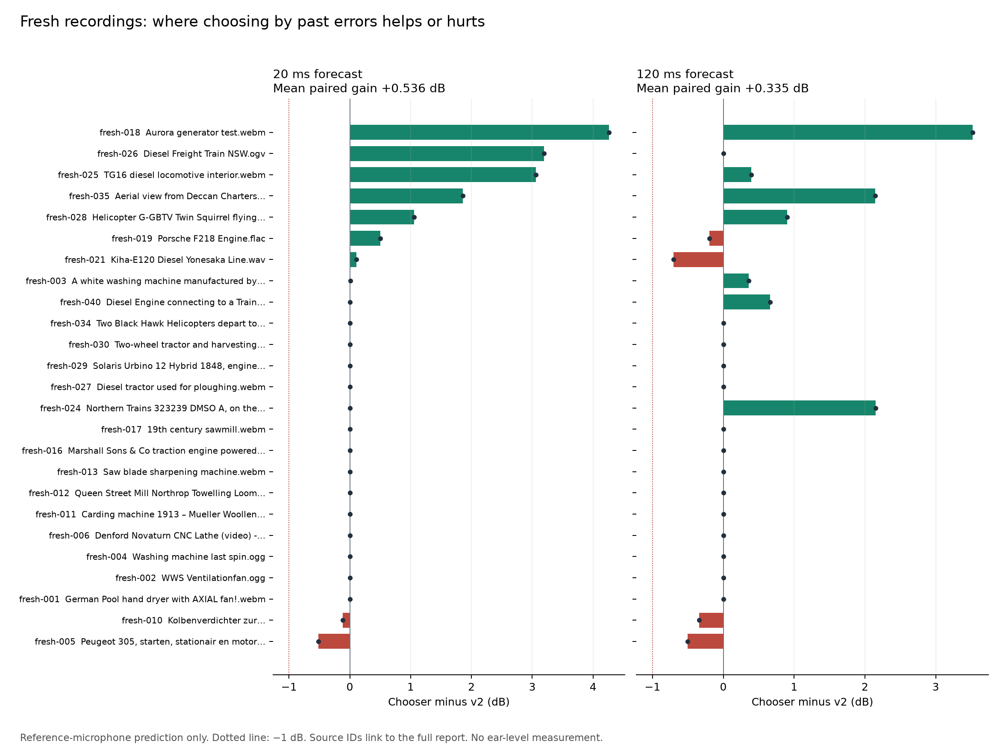

# Fresh test of the unchanged chooser

21 October 2026. **Pass frozen offline criteria.**
35 of 40 fixed sources were scored; 25 contained reference tones. The run used only the first 90 seconds at most, with a 40% calibration prefix and at least 30 seconds of scored target blocks per horizon.

These are reference-microphone prediction-error reductions. They are not measured sound cancellation at an ear. The live engine remains v2. No recording or playback occurred.

## Frozen decision

| Requirement | Result |
|---|---|
| at least 30 usable recordings | Met |
| at least 20 tonal recordings | Met |
| mean paired 20ms ci lower above zero | Met |
| no strong 20ms loss over 1db | Met |
| no more band boost cases both horizons | Met |
| no whole band boost cases both horizons | Met |

## Paired accuracy and amplification

| Measure | 20 ms | 120 ms |
|---|---:|---:|
| Mean paired tone gain (dB) | +0.536 | +0.335 |
| Median paired tone gain (dB) | +0.000 | +0.000 |
| Worst paired tone gain (dB) | -0.516 | -0.701 |
| 95% source-bootstrap interval for mean | [+0.121, +1.043] | [+0.016, +0.729] |
| Wins / ties / losses (practical tolerance) | 7 / 16 / 2 | 7 / 14 / 4 |
| Wins / ties / losses (numerical tolerance) | 8 / 14 / 3 | 7 / 13 / 5 |
| Sources with any third-octave boost ≥1 dB, chooser / v2 | 5 / 7 | 7 / 8 |
| Sources with whole low-band amplification >0.5 dB, chooser / v2 | 0 / 0 | 0 / 0 |

Practical ties: ±0.01 dB; numerical ties: ±1e-8 dB. Counts are source-by-horizon cases, not the total number of amplified bands. Whole band here means 35–350 Hz. Each source has equal weight. The 120 ms result does not model Bluetooth jitter or validate wireless use.

## Every scored source

| Source | Scored seconds | Tone bins | v2 20 ms | Chooser 20 ms | Paired Δ20 | Paired Δ120 |
|---|---:|---:|---:|---:|---:|---:|
| fresh-001: [German Pool hand dryer with AXIAL fan!.webm](https://commons.wikimedia.org/wiki/File:German_Pool_hand_dryer_with_AXIAL_fan!.webm) | 32.85 | 2 | +2.264 | +2.264 | -0.000 | +0.000 |
| fresh-002: [WWS Ventilationfan.ogg](https://commons.wikimedia.org/wiki/File:WWS_Ventilationfan.ogg) | 43.67 | 2 | +0.850 | +0.850 | +0.000 | +0.000 |
| fresh-003: [A white washing machine manufactured by Husqvarna in the 1990s.webm](https://commons.wikimedia.org/wiki/File:A_white_washing_machine_manufactured_by_Husqvarna_in_the_1990s.webm) | 33.85 | 3 | +2.819 | +2.826 | +0.007 | +0.358 |
| fresh-004: [Washing machine last spin.ogg](https://commons.wikimedia.org/wiki/File:Washing_machine_last_spin.ogg) | 35.62 | 5 | +6.365 | +6.365 | +0.000 | +0.000 |
| fresh-005: [Peugeot 305, starten, stationair en motor afzetten - SoundCloud - Beeld en Geluid.ogg](https://commons.wikimedia.org/wiki/File:Peugeot_305,_starten,_stationair_en_motor_afzetten_-_SoundCloud_-_Beeld_en_Geluid.ogg) | 53.87 | 6 | +8.801 | +8.286 | -0.516 | -0.506 |
| fresh-006: [Denford Novaturn CNC Lathe (video) - Nottingham Hackspace.webm](https://commons.wikimedia.org/wiki/File:Denford_Novaturn_CNC_Lathe_(video)_-_Nottingham_Hackspace.webm) | 31.76 | 3 | +8.335 | +8.335 | +0.000 | -0.000 |
| fresh-007: [Kente weaving machine 03.wav](https://commons.wikimedia.org/wiki/File:Kente_weaving_machine_03.wav) | 53.87 | 0 | N/A | N/A | N/A | N/A |
| fresh-009: [From line shaft to power looms.ogv](https://commons.wikimedia.org/wiki/File:From_line_shaft_to_power_looms.ogv) | 52.92 | 0 | N/A | N/A | N/A | N/A |
| fresh-010: [Kolbenverdichter zur Hummerbeckenbelüftung.webm](https://commons.wikimedia.org/wiki/File:Kolbenverdichter_zur_Hummerbeckenbel%C3%BCftung.webm) | 32.71 | 6 | +0.119 | +0.000 | -0.119 | -0.340 |
| fresh-011: [Carding machine 1913 – Mueller Woollen Cloth Mill.ogv](https://commons.wikimedia.org/wiki/File:Carding_machine_1913_%E2%80%93_Mueller_Woollen_Cloth_Mill.ogv) | 52.98 | 2 | +5.659 | +5.659 | +0.000 | +0.000 |
| fresh-012: [Queen Street Mill Northrop Towelling Loom Pegs and lags Unifill 8600.webm](https://commons.wikimedia.org/wiki/File:Queen_Street_Mill_Northrop_Towelling_Loom_Pegs_and_lags_Unifill_8600.webm) | 53.86 | 1 | +1.940 | +1.940 | +0.000 | +0.000 |
| fresh-013: [Saw blade sharpening machine.webm](https://commons.wikimedia.org/wiki/File:Saw_blade_sharpening_machine.webm) | 53.87 | 2 | +0.021 | +0.021 | +0.000 | +0.000 |
| fresh-016: [Marshall Sons & Co traction engine powered timber saw.ogg](https://commons.wikimedia.org/wiki/File:Marshall_Sons_%26_Co_traction_engine_powered_timber_saw.ogg) | 34.87 | 4 | +1.382 | +1.382 | +0.000 | +0.000 |
| fresh-017: [19th century sawmill.webm](https://commons.wikimedia.org/wiki/File:19th_century_sawmill.webm) | 53.87 | 4 | +7.613 | +7.613 | +0.000 | +0.000 |
| fresh-018: [Aurora generator test.webm](https://commons.wikimedia.org/wiki/File:Aurora_generator_test.webm) | 43.73 | 5 | +4.694 | +8.956 | +4.261 | +3.519 |
| fresh-019: [Porsche F218 Engine.flac](https://commons.wikimedia.org/wiki/File:Porsche_F218_Engine.flac) | 36.75 | 6 | +10.488 | +10.987 | +0.499 | -0.193 |
| fresh-020: [Ferrari 250 GTO, Engine Sound.ogg](https://commons.wikimedia.org/wiki/File:Ferrari_250_GTO,_Engine_Sound.ogg) | 35.80 | 0 | N/A | N/A | N/A | N/A |
| fresh-021: [Kiha-E120 Diesel Yonesaka Line.wav](https://commons.wikimedia.org/wiki/File:Kiha-E120_Diesel_Yonesaka_Line.wav) | 53.87 | 6 | +6.344 | +6.454 | +0.110 | -0.701 |
| fresh-022: [Tatra RT6N1 Engine Sound.ogg](https://commons.wikimedia.org/wiki/File:Tatra_RT6N1_Engine_Sound.ogg) | 42.63 | 0 | N/A | N/A | N/A | N/A |
| fresh-023: [London Underground 1995 Stock train going from Old Street station to Angel station.ogg](https://commons.wikimedia.org/wiki/File:London_Underground_1995_Stock_train_going_from_Old_Street_station_to_Angel_station.ogg) | 53.87 | 0 | N/A | N/A | N/A | N/A |
| fresh-024: [Northern Trains 323239 DMSO A, on the Crewe to Manchester line, Jan 2022.ogg](https://commons.wikimedia.org/wiki/File:Northern_Trains_323239_DMSO_A,_on_the_Crewe_to_Manchester_line,_Jan_2022.ogg) | 53.87 | 5 | +8.136 | +8.136 | +0.000 | +2.154 |
| fresh-025: [TG16 diesel locomotive interior.webm](https://commons.wikimedia.org/wiki/File:TG16_diesel_locomotive_interior.webm) | 53.87 | 6 | +1.094 | +4.153 | +3.059 | +0.393 |
| fresh-026: [Diesel Freight Train NSW.ogv](https://commons.wikimedia.org/wiki/File:Diesel_Freight_Train_NSW.ogv) | 43.43 | 1 | +0.217 | +3.408 | +3.192 | +0.000 |
| fresh-027: [Diesel tractor used for ploughing.webm](https://commons.wikimedia.org/wiki/File:Diesel_tractor_used_for_ploughing.webm) | 37.49 | 2 | +1.919 | +1.919 | +0.000 | +0.000 |
| fresh-028: [Helicopter G-GBTV Twin Squirrel flying over north London.webm](https://commons.wikimedia.org/wiki/File:Helicopter_G-GBTV_Twin_Squirrel_flying_over_north_London.webm) | 53.87 | 6 | +1.380 | +2.435 | +1.055 | +0.902 |
| fresh-029: [Solaris Urbino 12 Hybrid 1848, engine sounds, Szczecin, 2022.mp3](https://commons.wikimedia.org/wiki/File:Solaris_Urbino_12_Hybrid_1848,_engine_sounds,_Szczecin,_2022.mp3) | 32.98 | 2 | +4.523 | +4.523 | +0.000 | +0.000 |
| fresh-030: [Two-wheel tractor and harvesting potatoes.ogv](https://commons.wikimedia.org/wiki/File:Two-wheel_tractor_and_harvesting_potatoes.ogv) | 53.87 | 1 | +0.512 | +0.512 | +0.000 | +0.000 |
| fresh-031: [Steam locomotive Iron Horse of Otaru Museum.ogv](https://commons.wikimedia.org/wiki/File:Steam_locomotive_Iron_Horse_of_Otaru_Museum.ogv) | 53.87 | 0 | N/A | N/A | N/A | N/A |
| fresh-032: [Steam locomotive SJ S1 1921.webm](https://commons.wikimedia.org/wiki/File:Steam_locomotive_SJ_S1_1921.webm) | 31.90 | 0 | N/A | N/A | N/A | N/A |
| fresh-033: [Steam locomotive P-36 at the Pavlovskyi Posad station.webm](https://commons.wikimedia.org/wiki/File:Steam_locomotive_P-36_at_the_Pavlovskyi_Posad_station.webm) | 53.86 | 0 | N/A | N/A | N/A | N/A |
| fresh-034: [Two Black Hawk Helicopters depart to deliver Relief Items to Babuyan Claro, Calayan, Cagayan from Lal-Lo, Cagayan - 30 September 2025.webm](https://commons.wikimedia.org/wiki/File:Two_Black_Hawk_Helicopters_depart_to_deliver_Relief_Items_to_Babuyan_Claro,_Calayan,_Cagayan_from_Lal-Lo,_Cagayan_-_30_September_2025.webm) | 32.11 | 5 | +4.656 | +4.656 | +0.000 | +0.000 |
| fresh-035: [Aerial view from Deccan Charters helicopter at EXCON 2025 (BIEC) 03.webm](https://commons.wikimedia.org/wiki/File:Aerial_view_from_Deccan_Charters_helicopter_at_EXCON_2025_(BIEC)_03.webm) | 30.43 | 6 | +5.301 | +7.159 | +1.858 | +2.144 |
| fresh-036: [Diesel railcar Hydra CD 854 202-9 and semaphore signals at Nemotice station September 2026.webm](https://commons.wikimedia.org/wiki/File:Diesel_railcar_Hydra_CD_854_202-9_and_semaphore_signals_at_Nemotice_station_September_2026.webm) | 37.14 | 0 | N/A | N/A | N/A | N/A |
| fresh-039: [Steam Locomotive on a Turntable • Höyryveturi Hv1 555 kääntöpöydällä.webm](https://commons.wikimedia.org/wiki/File:Steam_Locomotive_on_a_Turntable_%E2%80%A2_H%C3%B6yryveturi_Hv1_555_k%C3%A4%C3%A4nt%C3%B6p%C3%B6yd%C3%A4ll%C3%A4.webm) | 53.87 | 0 | N/A | N/A | N/A | N/A |
| fresh-040: [Diesel Engine connecting to a Train (Coupling).webm](https://commons.wikimedia.org/wiki/File:Diesel_Engine_connecting_to_a_Train_(Coupling).webm) | 53.87 | 6 | +9.481 | +9.481 | +0.000 | +0.658 |

All gains above are dB. No-tone sources remain in amplification counts; they do not acquire a fictional tone score. Full comparator scores (zero, v2, joint guard, fade, prefix AR and chooser) remain in `test/results.json`.

## Exclusions

- **fresh-008: Cavitation in a gear pump.ogv** — No decodable first audio track: Stream map '' matches no streams. To ignore this, add a trailing '?' to the map. Failed to set value '0:a:0' for option 'map': Invalid argument Error parsing options for output file C:\Users\talk2.000\Desktop\Claude\predictive-anc\results-selector-fresh-01\test\decoded\fresh-008.wav. Error opening output files: Invalid argument 
- **fresh-014: Vacuum pump filter pour sample and turn on.webm** — No decodable first audio track: Stream map '' matches no streams. To ignore this, add a trailing '?' to the map. Failed to set value '0:a:0' for option 'map': Invalid argument Error parsing options for output file C:\Users\talk2.000\Desktop\Claude\predictive-anc\results-selector-fresh-01\test\decoded\fresh-014.wav. Error opening output files: Invalid argument 
- **fresh-015: Murray engine - Thinktank - Andy Mabbett - 2015-02-12 -01.flac** — No nominated small representation within the amended limit
- **fresh-037: Wurstelprater Wien 2024 GoKart Honda.ogg** — Audio decode failure: LibsndfileError: Error opening <_io.BytesIO object at 0x0000012B57513240>: Error : unknown error in flac decoder.
- **fresh-038: Freight train passes Phelan, startles Canadian geese.flac** — No nominated small representation within the amended limit

## Interpretation limits and audit trail

Claude’s correction was valid: a median of paired changes can be zero while the mean is positive when many outputs tie v2. The earlier audit’s median-based stop remains its historical prespecified outcome. Reinterpreting it and choosing L2 were development decisions; this new source test uses the mean endpoint frozen before audio access.

The 40-source metadata-selected pool has 2 fan/ventilation, 15 other machinery and 23 transport-engine recordings. It contains moving, changing and mixed-noise stress cases. It is not a representative sample of all steady hums. Forty distinct uploader and credited-author strings do not establish capture independence; 5 credited authors/collections overlap the earlier pool. Reference tone detection for scoring does not establish stationarity.

The bootstrap interval is conditional on this purposive source collection. It quantifies source variability under resampling, not uncertainty over every environment. The longer-clip association in the old audit does not prove that duration caused its ties.

The tested chooser is a causal DSP selection rule with a two-second completed-error history. It starts from v2 and can select the faded tracker or zero only on past evidence. Source calibration precedes scoring. This experiment does not test frozen neural-model transfer, measured output latency, clock drift, Bluetooth jitter, or the reference-to-ear acoustic path.

The public recordings have unknown microphones, processing and recording conditions. Official transcodes are lossy; these measurements concern the decoded reference waveforms, not calibrated raw acoustic pressure.

**Two pre-scoring operational deviations are disclosed.** Commons requested smaller copies after rejecting larger originals. One representation per fixed source was nominated uniformly before downloading those copies; two sources had no eligible representation. Derivative checksums are local receipts tied to official API URLs and parent identities, not externally published checksums. A metadata-routing bug for Ogg video containers was then corrected before any decoding or scoring. The original runner and protocols are preserved; no prediction, source-selection, cropping or scoring rule was tuned.

Acquisition: 38/40 files; 205,064,635 bytes in the final input batch. Failed original attempts are retained separately. Scoring wall time: 9.9 minutes; this offline process-pool timing is not a real-time deadline benchmark.

Validation: 125 receipt/aggregation checks passed; 18 targeted unit checks passed (0.510 s), including causal maturity, transitions, seen-score parity and video dispatch. No full-suite rerun is claimed. No predictor was rerun to make this report.

| Artifact | SHA-256 |
|---|---|
| [protocol.json](protocol.json) | `f395e6a2b9b20dfc4ac5d9d2b33f07e6f9b4c8ed4ead0240fb333e5b8b974308` |
| [acquisition-amendment-01.json](acquisition-amendment-01.json) | `c77ec958c0b8c07856e9997589ed973afcd51f9b65498dc83eded7f22fefea26` |
| [decoder-amendment-02.json](decoder-amendment-02.json) | `d4a400d1242f25ce7be08847a711cdd2808d261bda26cb9fcc75f6cfd5e1b426` |
| [download/manifest.json](download/manifest.json) | `b8ea3b0cbb3d64c08da60357495dbe274b718491883de44038649e43b837c326` |
| [test/results.json](test/results.json) | `2653ac76f20cb44b2656a52dba31e200acdbebea0b62e6635aa22750002d72e3` |
| [SUMMARY.json](SUMMARY.json) | `3d94f33d1af9c139f7d724db7ea3aa23ecdf847ac2d75e3881864e5eb55b44fc` |

