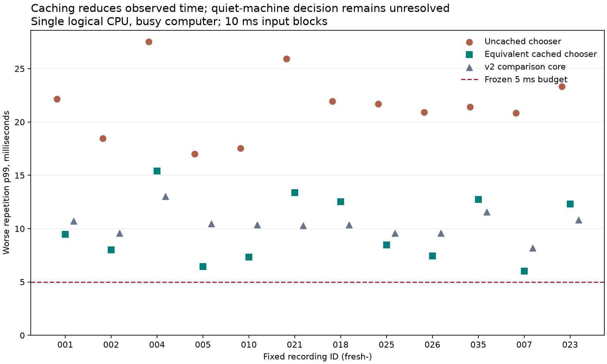

# Chooser timing: useful speedup, quiet-machine gate unresolved

22 October 2026. Offline engineering profile on saved, already-seen reference signals. No audio device was opened. The live engine remains v2.

**Decision: inconclusive under the frozen quiet-machine rule.** All three preflight windows were busy, so none of the 72 runs qualifies for a quiet-machine verdict. Both chooser versions miss the observed 5 ms p99 budget on this loaded machine. This is evidence of a deployment risk under load, not a definitive quiet-machine failure.

The bounded streaming implementation and the DPSS cache reproduce all saved forecasts on the 12 specified recordings (largest absolute difference 0); all 24 standalone chooser-decision arrays match exactly. Every timed run also passed forecast parity. The cache changes repeated mathematical work, not the prediction rule.

## Observed processing times

Each row covers 24 runs (12 sources × two repetitions), 70,800 measured 10 ms blocks. A p99 means 99% of measured blocks completed within that time; it is not the maximum or a deadline guarantee. The criterion requires **every** run p99 below 5 ms and quiet qualification.

| Forecast core | Per-run p99 range (ms) | Median run p99 (ms) | Runs below 5 ms | Blocks above 5 ms | Blocks above 10 ms | Slowest block (ms) |
|---|---:|---:|---:|---:|---:|---:|
| Uncached chooser | 14.15–27.53 | 18.66 | 0/24 | 9,410/70,800 | 2,970/70,800 | 63.74 |
| Equivalent cached chooser | 4.52–15.41 | 7.77 | 1/24 | 9,466/70,800 | 661/70,800 | 59.74 |
| v2 comparison core | 5.94–13.04 | 9.16 | 0/24 | 3,050/70,800 | 455/70,800 | 42.45 |

The cache lowered p99 in 24/24 source/repetition comparisons, with a median relative reduction of 57.2%. These are sequential measurements under changing contention, not an isolated causal estimate of the optimization. The uncached v2 comparison also misses the observed budget; it uses this adapter and is not a measurement of the complete current app.

The cache did **not** reduce the number of blocks above the stricter 5 ms reserve threshold in this run (9,466 versus 9,410). The improved p99 and >10 ms count therefore do not imply fewer misses at every threshold.

The plot and table below retain the worse repetition for each source; no favorable interval was selected.

| Source | Uncached p99 (ms) | Cached p99 (ms) | v2 core p99 (ms) |
|---|---:|---:|---:|
| fresh-001: File:German Pool hand dryer with AXIAL fan!.webm | 22.16 | 9.47 | 10.72 |
| fresh-002: File:WWS Ventilationfan.ogg | 18.46 | 8.01 | 9.57 |
| fresh-004: File:Washing machine last spin.ogg | 27.53 | 15.41 | 13.04 |
| fresh-005: File:Peugeot 305, starten, stationair en motor afzetten - SoundCloud - Beeld en Geluid.ogg | 17.01 | 6.46 | 10.45 |
| fresh-010: File:Kolbenverdichter zur Hummerbeckenbelüftung.webm | 17.55 | 7.33 | 10.35 |
| fresh-021: File:Kiha-E120 Diesel Yonesaka Line.wav | 25.94 | 13.38 | 10.28 |
| fresh-018: File:Aurora generator test.webm | 21.96 | 12.52 | 10.36 |
| fresh-025: File:TG16 diesel locomotive interior.webm | 21.68 | 8.46 | 9.58 |
| fresh-026: File:Diesel Freight Train NSW.ogv | 20.91 | 7.45 | 9.58 |
| fresh-035: File:Aerial view from Deccan Charters helicopter at EXCON 2025 (BIEC) 03.webm | 21.41 | 12.72 | 11.56 |
| fresh-007: File:Kente weaving machine 03.wav | 20.85 | 6.02 | 8.20 |
| fresh-023: File:London Underground 1995 Stock train going from Old Street station to Angel station.ogg | 23.32 | 12.32 | 10.82 |

## Measurement scope and limits

- Windows, Python 3.12.10, 24 physical cores / 32 logical processors. Timed process restricted to logical processor 5; numerical-library threads limited to one. Affinity restored by the benchmark's finally block.
- Preflight whole-machine CPU: 20.22%, 20.20%, 16.65%, each above the 5% limit. During-run estimated background CPU ranged 9.43–24.57%. The Windows aggregate estimate is conservative/approximate; the preflight alone makes every run unqualified.
- Includes both independent detectors, both 20/120 ms forecast horizons, matured-error gates, filtering/error history, chooser decisions and sample crossfades. Includes startup and detector-update blocks; late-suffix summaries remain in the raw report.
- Excludes decoding, normalization, resampling, UI, device-rate synthesis, audio callbacks, hardware transport, and ear acoustics. The reserved half-block does not measure these costs. No claim of complete app scheduling performance.
- Windows thread CPU accounting is coarse: 86.0% of block samples are zero; nonzero values occur in 15.625 ms increments. Use high-resolution wall time for the gate. CPU-time p99 is not a valid per-block execution-cost estimate here.
- Timing instrumentation has overhead. Part-wise p99 values are not additive. Sequential source repetitions share a changing CPU environment; this is one machine, one schedule, a bounded selection of seen recordings.
- The scoped DPSS cache is a research implementation that temporarily replaces the SciPy function and restores it afterward. A thread-safe production cache/integration would require separate checks.

## Tuning integration: specific missing check

The existing tuning simulator uses per-tone complex amplitudes; the fresh chooser emits mixed waveform blocks. A faithful adapter must carry the original tone frequencies and amplitudes, per-tone release/ghost components, gates and sample-level chooser fades. It must reconstruct the tested 20/120 ms forecasts before any room result is interpreted. The older room simulator uses 30/200 ms leads, so that mapping must be explicit.

There is also a renderer mismatch to resolve explicitly: the live v2 renderer excludes the fitted DC term and ramps its gate across a block, while the fresh reference forecast gates the entire block (including DC). Reusing the fresh prediction score as proof of equivalent tuned output would be incorrect. No tuning-switch result is claimed yet.

The prepared room plan preserves 48 existing room/source draws, prefix-only tuning and fixed suffix settings. It includes simulated-ear amplification, clipping and switch-window checks plus a deliberately biased switching control. Its adapter, mapping, coverage and harm rules still need to be frozen before execution.

## Next action

Retain the fresh accuracy pass and current live v2 engine. Keep this contended diagnostic intact. A separate, newly recorded repetition under an actually quiet CPU environment is needed for the quiet-machine decision; do not stop unrelated work. The equivalent cache is the first optimization to retain. Any smaller/rotating tracker bank changes the candidate and needs new accuracy validation.

The independent work available now is the component/renderer parity adapter and the fixed-tuning simulation. Even passing both engineering checks would support a proposal for an engine change, not physical ANC. Real ear-level evidence still needs measured paths, timing and a calibrated low-output near-ear fixture.

## Reproducibility

- Frozen protocol SHA256: `786df9ff4847ffc5c692defbcbf74cd03d64c440a3de1428dbf8b68caea184a4`.
- Saved timing results SHA256: `9c43b36f5e6ac33f18f7d313b566253c943aa5f5a88eebd51b8982cf3a7a589f`.
- 1093 report/receipt checks passed, including recomputation from every timing array and verification of all frozen code. Three targeted streaming/cache unit checks passed before freezing; no new full-suite claim.
- `protocol.json`, `frozen.json`, `parity/`, `timing/`, `SUMMARY.json` and `VERIFICATION.json` preserve the schedule, samples, outcomes and receipts. Reference audio/forecast arrays remain local.

## Follow-on, 22 October: component reconstruction completed

The component adapter now exists and passed all 36 method/source comparisons, including 10/7 actual chooser transitions. See [its report](../results-selector-components-01/REPORT.md). The room test and old-room baseline reproduction are still pending. This does not alter the timing measurements or promote the engine.
