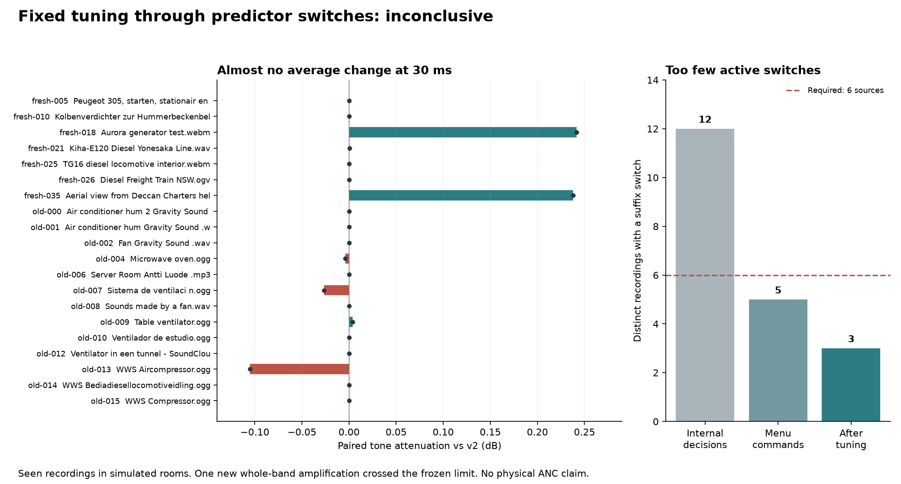

# Fixed tuning through chooser switches

Completed 24 October 2026. **Inconclusive switch coverage, with an observed primary harm-limit breach. Keep v2 live.**

All 72 preselected rooms were scored once. The original 48 rooms exercised four qualifying sources; the fixed 24-room supplement raised this only to five, below the required six. Reusing v2's tuning also produced one new whole-band amplification above the prewritten 0.5 dB limit. The formal frozen label gives coverage precedence; it must not be read as absence of harm or a pass.

This is **simulated ear attenuation on already-seen recordings**, not new-source validation, a listening test or physical ANC. The separate fresh microphone-prediction result of +0.536 dB remains unchanged. It does not transfer automatically to the ear or to this fixed-tone tuning interface.

## Primary and secondary outcomes

There are 24 source recordings, three room draws each. Twenty sources have reference tone metrics; all 72 rooms remain in the harm and exposure checks. Average paired tone differences within each source first, then give each source equal weight. Intervals are the frozen 20,000 source bootstrap draws, seed 20261022. Positive differences favor the chooser; they are means of dB differences, not pooled energy reductions.

| Lead ms | Tuning | Mean paired dB | 95% interval | Worst source dB | New amplification entries | Max switch excess dB | Coverage sufficient |
| --- | --- | --- | --- | --- | --- | --- | --- |
| 30 | Reuse v2 tuning | +0.0174 | [-0.0118, +0.0550] | -0.1051 | 1 | +0.0126 | No |
| 30 | Tune chooser on its prefix | +0.0486 | [+0.0013, +0.1115] | -0.0267 | 0 | +0.0126 | No |
| 200 | Reuse v2 tuning | +0.0073 | [-0.0060, +0.0233] | -0.0683 | 0 | +0.0318 | No |
| 200 | Tune chooser on its prefix | -0.0163 | [-0.0472, +0.0026] | -0.2713 | 1 | +0.0318 | No |

Only 30 ms with reused v2 settings is primary. Own-prefix tuning is secondary. All 200 ms outcomes are exploratory: there is no inherited validation beyond the earlier 120 ms forecast horizon. None of these arms passes the coverage rule.

The primary mean is **+0.0174 dB**, interval **−0.0118 to +0.0550 dB**; the worst source mean is **−0.1051 dB**. Those satisfy the numerical mean/source noninferiority margins but do not erase the whole-band harm or missing exposure. No extra clipping was found in any arm. No complete switch window exceeded the +3 dB energy limit; this establishes neither inaudibility nor physical safety.

## Amplification must not be hidden by an average

| Lead ms | Arm | Room | Band Hz | Candidate amplification dB | V2 amplification dB |
| --- | --- | --- | --- | --- | --- |
| 30 | chooser_reuse_v2 | old-013-r2 | 35-350 | 0.5703 | 0.3243 |
| 200 | chooser_tuned | fresh-035-r2 | 100.0 | 1.2277 | 0.0005 |

At 30 ms, `old-013-r2` is **WWS_Aircompressor.ogg**. Its 35–350 Hz residual is 0.5703 dB above no control, versus 0.3243 dB for v2. The difference is +0.2460 dB in residual power level; the **absolute** 0.5 dB threshold is what it crosses. It switched from v2 to the bank around 5.63 s, before the scored suffix begins at 25.44 s, and never switched again. This is a persistent compatibility outcome, not an observed jump at a scored switch. Its active v2-tuned tone was about 193.91 Hz. Whether forecast phase, level, availability or their interaction with the ear path is responsible remains unmeasured.

At 200 ms, chooser-own tuning newly amplifies the helicopter room `fresh-035-r2` at 100 Hz by 1.2277 dB; v2 is essentially neutral there. This exploratory failure is retained. At 30 ms, reused tuning introduced no new third-octave crossing; its failure is the whole-band entry above.

## What the switch coverage actually exercised

| Lead ms | Original qualifying sources | All qualifying sources | All suffix switches | Qualifying menu switches | Incomplete windows | Actual tuned-output switches | Actual tuned-output sources |
| --- | --- | --- | --- | --- | --- | --- | --- |
| 30 | 4 | 5 | 29 | 11 | 1 | 7 | 3 |
| 200 | 3 | 4 | 51 | 12 | 1 | 8 | 3 |

The first coverage definition was fixed before scoring: a prefix-menu tone with unit gain must create nonzero command around a complete ±100 ms window. The last two columns are a **post-hoc descriptive audit** using the actual reused settings; they do not change inclusion or the frozen outcome. Only three distinct recordings have nonzero tuned output during a complete scored switch at either lead. A tiny nonzero command is still only an exposure test, not an audibility criterion.

At 30 ms the simulated listener muted every v2-tuned tone in **28/48 original rooms and 18/24 supplemental rooms**. The locomotive interior and freight train have no eligible prefix-menu tone in any of their three rooms. The helicopter switches before scoring in the two rooms where it switches at all. Thus adding recordings that benefited in the microphone test did not ensure meaningful fixed-tuning switch exposure. Silent ties cannot validate the switch behavior.

Every switch, including incomplete windows, is in [switch-windows.csv](switch-windows.csv). All source/room exposure counts and prefix transitions are in [coverage-audit.csv](coverage-audit.csv). No further recordings were added after the single planned expansion.

## Original cohort retained separately

| Lead ms | Arm | Mean paired dB | 95% interval | New amplification entries |
| --- | --- | --- | --- | --- |
| 30 | chooser_reuse_v2 | -0.0101 | [-0.0278, +0.0003] | 1 |
| 30 | chooser_tuned | +0.0159 | [-0.0059, +0.0540] | 0 |
| 200 | chooser_reuse_v2 | +0.0011 | [-0.0128, +0.0123] | 0 |
| 200 | chooser_tuned | -0.0042 | [-0.0169, +0.0065] | 0 |

The original cohort has 16 sources, 13 with reference tone metrics; it also has insufficient switch coverage. The supplemental eight sources were intentionally enriched using already-seen accuracy results, not sampled as a representative deployment population. Source-bootstrap intervals here are descriptive for this development experiment.

## Rendering and calibration boundaries

Both predictors consume x[0] onward and share newest-sample origin `seen-1`. The unchanged chooser uses matured hard-gated 20/120 ms errors; the room renderer synthesizes actual 30/200 ms forecasts. The primary output has no DC and uses the live block-ramped gates, per-tone settings and sample-level chooser crossfade. It does not move an old 20 ms waveform into a 30 ms slot.

Each arm uses the original first-40% tuning prefix and the same source/room seeds. Settings stay fixed during scoring. The prefix-selected tone menu is shared; newly tracked frequencies outside that menu stay silent. The simulated listener's judgement noise is 1 dB. This checks the current interface's compatibility, not automatic calibration of arbitrary newly appearing tones.

Modal source-to-microphone and source-to-ear paths, a modeled earphone high-pass filter and an extra 3 ms delay are known to the simulator. Input levels and earphone gain are model normalizations. The output cap is digital, not calibrated SPL. These runs use fixed leads; they do not measure or establish robustness to Bluetooth jitter, acoustic leakage, clock drift or head movement. Physical validation still needs low-output calibrated hardware and near-ear measurement.

The [retuning bound](retune-bound.csv) uses future ear errors and unconstrained piecewise complex coefficients before the acoustic/evaluation filters, with no output cap. It is an upper bound only for that specified unclipped linear tone family, not achievable listener performance; it never enters the pass decision. Secondary hard/DC reference scores remain in the case JSON and are not ear-attenuation evidence.

## Verification and amendments

- Original 48-room reproduction: **59,939 numeric scalar comparisons, maximum error zero**, plus matching nonnumeric structure. Timing fields were excluded.
- Shared-origin control: all 16 synthetic scene/lead comparisons pass; worst inter-predictor phase difference 0.65782 degrees and level difference 0.0127263 dB. These bounded controls do not guarantee agreement on recorded sources.
- Seven targeted room checks pass, including causality, exact-lead rendering, the chooser rule, source weighting, a deliberately harmful phase switch and zero-output parity. The full historical suite was not rerun.
- All **576 metric rows**, **80 suffix events** (78 complete windows), saved noncausal coefficient reconstructions, source bootstrap results and harm decisions were audited from stored traces/settings. Maximum numerical difference: **1.06e-14**. The native tone renderer and SciPy primitives are shared; this is not an independent implementation of the full predictor.
- The original v2 control reproduces the prior room tuning/outcome comparisons in the scoring run (2,668 compared values); the audit separately rechecked its scalar metrics and full tuning structures.
- A pre-scoring amendment changes only the muted command's `worst_third_octave_hz` from an arbitrary tied band to `null`, matching the original baseline. Active metrics/signals are identical. **All original frozen code and protocol files remain byte-for-byte unchanged.** The new completion wrapper, tests and check log have their own hash seal.

Protocol: `8835447fded601cb936ff2c508638c3f1946e14be14c0646abb15f2341543f33`. Coverage seal: `9ef69f63484f6ee68eb032b568ba235fc2ca5659e53ce9ec2476184692f28680`. Pre-scoring amendment: `77bd875c8d2ba5c43aa6678736e06665c62cf8893a912204aaba21be594a9d55`. Results: `2c54bde410207e530c2effde621ea7b2d480fa96a33c19c15ac602b959865232`. Verification: `9eb969e436cf7389330595e71a09b09054b55bfb1f4cab2c68d0e32b58a1cdd3`.

The protocol, baseline and alignment checks were frozen/completed on 22 October. Coverage was sealed at 15:10 UTC on 22 October. The resumed run documented the null-value amendment before scoring on 24 October. There was no predictor change, threshold adjustment, replacement source, recording, playback or download in this continuation.

## Next bounded work

Keep v2 in the live app and retain the chooser as an offline reference-prediction candidate. Diagnose the three existing air-compressor rooms first: track the tuned tones' relative predictor phase, level, gate/availability and simulated ear residual at the actual 30 ms lead, including the prefix switch. Do not retune the selector on this result.

Then write a separate development stress-test protocol that deliberately exercises nonzero automatically discovered tones across controlled predictor switches, with known paths, phase/level mismatch controls and the same live renderer. Count actual tuned-command exposure before suffix scores and keep natural chooser switches separate from forced diagnostic switches. Do not call this fresh validation or keep extending this completed cohort until it passes.

The quiet-machine timing gate is still unresolved. Interleaved old/new measurements could improve the contended comparison, but would not replace that gate. Neither timing nor tuning currently justifies promotion. Claude is being asked to challenge this next scope before a new benchmark is frozen.

## Artifacts

[All metrics](metrics.csv), [all bands and their off/on powers](bands.csv), [source means](source-means.csv), [tuning settings](settings.csv), [switch windows](switch-windows.csv), [coverage audit](coverage-audit.csv), [noncausal bound](retune-bound.csv), [raw aggregate](results.json), [verification receipt](verification.json), [frozen protocol](protocol.json), [pre-scoring amendment](pre-scoring-amendment-01.json).
