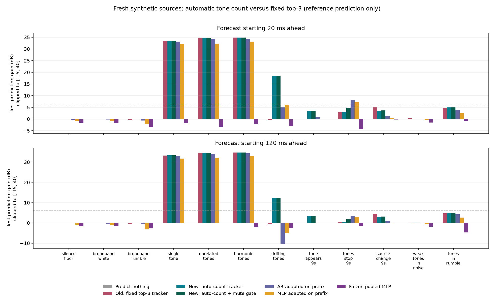

# Automatic tone count and confidence: first study

Synthetic **reference-signal prediction** only. No acoustic path, playback or ear measurement. Not evidence of real-world noise cancellation.

## Settings frozen on development scenes before any test scene was made

- Detector: multitaper line test, 1 s window, NW=4, family false-alarm level 0.01 per window, active after 2 of 3 passing updates, released after 4 missed updates, update every 0.25 s.
- Warm-up before the first possible detection: 1.25 s. No prefix fit and no frequency labels.
- Mute gate: output enabled only when recent fully-matured forecasts beat zero by at least -1 dB.

## Detection on fresh test scenes (test window 8–12 s, 17 updates)

| Scene | True tones (test) | New: false / missed | New: freq error | Old top-3: false / missed | Transition latency | Final active (Hz) |
|---|---|---:|---:|---:|---|---|
| silence_floor | none | 0 / 0 | — | 48 / 0 | — | none |
| broadband_white | none | 0 / 0 | — | 48 / 0 | — | none |
| broadband_rumble | none | 3 / 0 | — | 48 / 0 | — | 151.71 |
| single_tone | 133.9 | 0 / 0 | 0.01 Hz | 32 / 0 | — | 133.911 |
| unrelated_tones | 62.8, 171.3, 288.4 | 0 / 0 | 0.03 Hz | 0 / 0 | — | 62.777, 171.269, 288.425 |
| harmonic_tones | 85.3, 170.6, 255.9 | 0 / 0 | 0.03 Hz | 0 / 0 | — | 85.326, 170.631, 255.866 |
| drifting_tones | 141.2, 276.5 | 0 / 0 | 0.24 Hz | 41 / 25 | — | 146.843, 282.111 |
| tone_appears_9s | 197.7 | 0 / 4 | 0.03 Hz | 48 / 12 | onset_197.7Hz: 1.25 s | 197.724 |
| tones_stop_9s | 77, 223.6 | 6 / 0 | 0.03 Hz | 40 / 0 | offset_77Hz: 1.00 s, offset_223.6Hz: 1.00 s | none |
| source_change_9s | 126.4, 208.9, 311.8 | 3 / 8 | 0.03 Hz | 32 / 12 | offset_126.4Hz: 1.00 s, onset_208.9Hz: 1.25 s, onset_311.8Hz: 1.25 s | 208.867, 311.77 |
| weak_tones_in_noise | 66.2, 247.3 | 0 / 20 | 0.11 Hz | 16 / 0 | — | 66.28 |
| tones_in_rumble | 44.6, 137.2 | 0 / 0 | 0.02 Hz | 16 / 0 | — | 44.554, 137.193 |

False and missed counts are summed over updates (a tone missed for 4 updates counts 4).

## Test prediction gain, 35–350 Hz band (dB; negative = worse than predicting nothing)

| Scene | Horizon | Old: fixed top-3 tracker | New: auto-count tracker | New: auto-count + mute gate | AR adapted on prefix | MLP adapted on prefix | Frozen pooled MLP | Validation pick |
|---|---:|---:|---:|---:|---:|---:|---:|---|
| silence_floor | 20 ms | -0.14 | 0.00 | 0.00 | -0.27 | -0.75 | -1.63 | zero |
| silence_floor | 120 ms | -0.06 | 0.00 | 0.00 | -0.20 | -0.83 | -1.61 | zero |
| broadband_white | 20 ms | -0.11 | 0.00 | 0.00 | -0.23 | -0.93 | -1.76 | zero |
| broadband_white | 120 ms | -0.11 | 0.00 | 0.00 | -0.30 | -0.95 | -1.50 | zero |
| broadband_rumble | 20 ms | -0.39 | -0.01 | -0.01 | -0.61 | -2.16 | -3.35 | zero |
| broadband_rumble | 120 ms | -0.53 | -0.00 | -0.00 | -0.34 | -3.20 | -2.75 | zero |
| single_tone | 20 ms | 33.31 | 33.39 | 33.39 | 33.19 | 31.95 | -1.80 | auto_selected_tracker |
| single_tone | 120 ms | 33.26 | 33.31 | 33.31 | 33.13 | 31.79 | 0.01 | auto_selected_tracker |
| unrelated_tones | 20 ms | 34.68 | 34.68 | 34.68 | 34.28 | 32.26 | -3.37 | fixed_top3_tracker |
| unrelated_tones | 120 ms | 34.50 | 34.50 | 34.50 | 34.17 | 31.99 | 0.03 | fixed_top3_tracker |
| harmonic_tones | 20 ms | 34.82 | 34.82 | 34.82 | 34.36 | 33.18 | -2.12 | auto_selected_tracker |
| harmonic_tones | 120 ms | 34.75 | 34.75 | 34.75 | 34.31 | 33.09 | -1.86 | auto_selected_tracker |
| drifting_tones | 20 ms | -0.35 | 18.37 | 18.37 | 4.97 | 6.20 | -3.03 | auto_selected_tracker |
| drifting_tones | 120 ms | -0.55 | 12.51 | 12.51 | -10.25 | -5.08 | -2.52 | auto_selected_tracker |
| tone_appears_9s | 20 ms | -0.01 | 3.54 | 3.54 | 0.81 | -0.07 | -0.16 | zero |
| tone_appears_9s | 120 ms | -0.01 | 3.34 | 3.34 | -0.14 | -0.04 | 0.04 | zero |
| tones_stop_9s | 20 ms | 2.91 | 2.92 | 4.81 | 8.19 | 7.08 | -4.22 | auto_selected_tracker |
| tones_stop_9s | 120 ms | 0.58 | 0.59 | 1.89 | 3.52 | 3.03 | -1.38 | auto_selected_tracker |
| source_change_9s | 20 ms | 5.08 | 3.49 | 3.70 | 1.29 | 0.47 | -0.22 | auto_selected_tracker |
| source_change_9s | 120 ms | 4.34 | 2.90 | 3.12 | 0.90 | -0.16 | 0.06 | auto_selected_tracker |
| weak_tones_in_noise | 20 ms | 0.28 | 0.12 | 0.12 | 0.00 | -0.54 | -1.50 | fixed_top3_tracker |
| weak_tones_in_noise | 120 ms | 0.21 | 0.11 | 0.11 | 0.02 | -0.55 | -1.89 | fixed_top3_tracker |
| tones_in_rumble | 20 ms | 4.90 | 5.06 | 5.06 | 3.87 | 2.43 | -0.76 | auto_selected_tracker |
| tones_in_rumble | 120 ms | 4.78 | 4.84 | 4.84 | 4.31 | 2.65 | -4.72 | fixed_top3_tracker |

## Re-analysis of earlier real recordings (not independent evidence)

These recordings and their 18–30 s test segments were already reported. Settings come from synthetic development scenes only.

| File | Tone-count share of updates | Most frequent active lines | 20 ms: ungated / gated / gate on | 120 ms: ungated / gated / gate on |
|---|---|---|---|---|
| reference.wav | 0: 100% | none | 0.00 / 0.00 dB / 100% | 0.00 / 0.00 dB / 100% |
| goal1_fan_01.wav | 0: 66%, 1: 25%, 2: 8% | 106 Hz (18%), 105 Hz (11%), 318 Hz (7%), 52 Hz (3%), 70 Hz (3%) | 0.00 / 0.00 dB / 100% | -0.00 / -0.00 dB / 100% |
| fan_off.wav | 0: 100% | none | 0.00 / 0.00 dB / 100% | 0.00 / 0.00 dB / 100% |
| fan_on.wav | 0: 5%, 1: 46%, 2: 44%, 3: 5% | 41 Hz (95%), 330 Hz (20%), 124 Hz (15%), 165 Hz (11%), 289 Hz (4%) | 0.18 / 0.18 dB / 100% | 0.17 / 0.17 dB / 100% |

## Limits

- One seed per scene and twelve scene types; development and test share scene *types* but not frequencies or seeds.
- The mute gate needs a matured forecast history; it reacts to a change only after the forecast horizon plus the lookback.
- Tones closer than the taper half-bandwidth are reported as one line.
- Synthetic white/brown noise is not a microphone with unknown processing. A fresh real recording with user readiness is the next real-data test.
- Frozen pooled MLP fit: 180 iterations; warnings in selection_study.json.
- Runtime 146.9 s.
