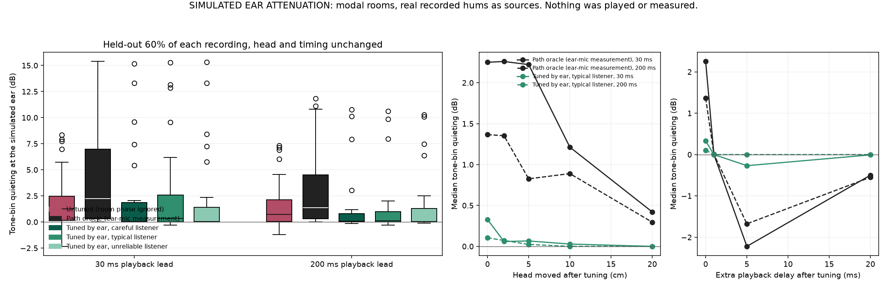

# Tune-by-ear in simulated rooms with real recorded hums

**Simulated ear attenuation.** Every number below is computed sound at a simulated ear in a simulated room. Nothing was played through earphones and nothing was measured. This is not evidence of real-world noise cancellation; it checks whether the procedure can find the right setting when the room, the earphones and the listener behave as modelled.

Protocol frozen before the run in `protocol.json` (seed 20261017). Recordings: 16 acoustic files from Wikimedia Commons (the two electrical mains-hum clips are excluded), 3 random rooms each. Tones were chosen and tuned on the first 40% of each recording only; the remaining 60% was evaluated with every setting frozen. No setting of the engine, the tuning procedure or the simulation was changed after seeing these results.

## Summary (computed from the tables below)

- Scenes: 48 (recording × room). In 28 the engine held at least one steady tone for most of the tuning part (tones per scene: median 1, max 3); the other 20 had nothing to tune, so every arm stays silent there and scores 0 dB.
- At the tones, 30 ms lead, head still: tuned by a typical simulated listener 0.3 dB median quieting; path oracle 2.3 dB; untuned 1.3 dB. No anti-hum is 0 dB by definition.
- Whole 35–350 Hz band (what is actually heard, including the broadband part nobody can predict): tuned 0.0 dB, oracle 0.3 dB. This is limited by how much of each hum is steady tone (see the per-recording table).
- Making things worse: any one-third-octave band louder by more than 1 dB in 7% of tuned scenes (18% untuned, 18% oracle); whole band louder by more than 0.5 dB in 0% (untuned 4%). Across all listeners and both leads: 4% and 0%.
- Tuning cost per tone (typical listener): median 90 s of listening and 15 answers; 49% of tuned tones passed the final on/off check.
- Moving the head after tuning (typical listener, 30 ms): 2 cm 0.1 dB, 5 cm 0.1 dB, 10 cm 0.0 dB, 20 cm 0.0 dB.
- Playback delay changing after tuning: +1 ms 0.0 dB, +5 ms -0.3 dB, +20 ms -0.0 dB. A delay change must trigger a retune (or be measured); it cannot be tolerated silently.
- Bluetooth-like 200 ms lead: tuned 0.1 dB at the tones, oracle 1.4 dB (forecasting further ahead costs accuracy when tones wander).
- Engine gate open for 100% (median) of held-out blocks that had tones.

## Every arm, head still, timing unchanged

Median [quartiles] over scenes with at least one tuned tone. Tone bins: ±1.5 Hz around the reference tones found non-causally in the earlier real-hum study (an independent yardstick, not the tuned frequencies).

| Arm | Lead (ms) | Tone bins (dB) | 35–350 Hz (dB) | Broadband (dB) | Worst 1 s window (dB) | Any 1/3-oct boost > 1 dB | Band louder > 0.5 dB | Peak drive |
|---|---:|---:|---:|---:|---:|---:|---:|---:|
| Untuned (room phase ignored) | 30 | 1.3 [0.1, 2.5] | 0.1 [0.0, 0.6] | 0.0 [0.0, 0.2] | -0.0 [-0.0, 0.1] | 18% | 4% | 0.211 |
| Path oracle (ear-mic measurement) | 30 | 2.3 [0.3, 7.0] | 0.3 [0.1, 0.7] | 0.0 [0.0, 0.3] | 0.0 [-0.0, 0.2] | 18% | 0% | 0.210 |
| Tuned by ear, careful listener | 30 | 0.0 [0.0, 1.9] | 0.0 [0.0, 0.4] | 0.0 [0.0, 0.1] | 0.0 [-0.0, 0.0] | 7% | 0% | 0.033 |
| Tuned by ear, typical listener | 30 | 0.3 [0.0, 2.6] | 0.0 [0.0, 0.4] | 0.0 [0.0, 0.0] | 0.0 [-0.0, 0.1] | 7% | 0% | 0.034 |
| Tuned by ear, unreliable listener | 30 | 0.1 [0.0, 1.4] | 0.0 [0.0, 0.3] | 0.0 [0.0, 0.0] | 0.0 [-0.0, 0.0] | 7% | 0% | 0.077 |
| Untuned (room phase ignored) | 200 | 0.7 [0.1, 2.1] | 0.0 [-0.0, 0.5] | 0.0 [-0.0, 0.2] | -0.1 [-0.4, -0.0] | 29% | 4% | 0.211 |
| Path oracle (ear-mic measurement) | 200 | 1.4 [0.3, 4.5] | 0.1 [0.0, 0.6] | 0.0 [0.0, 0.2] | -0.1 [-0.2, 0.1] | 25% | 4% | 0.211 |
| Tuned by ear, careful listener | 200 | 0.1 [0.0, 0.8] | 0.0 [0.0, 0.1] | 0.0 [0.0, 0.0] | 0.0 [-0.0, 0.0] | 4% | 0% | 0.082 |
| Tuned by ear, typical listener | 200 | 0.1 [0.0, 1.0] | 0.0 [0.0, 0.1] | 0.0 [0.0, 0.0] | 0.0 [-0.0, 0.0] | 7% | 0% | 0.049 |
| Tuned by ear, unreliable listener | 200 | 0.0 [0.0, 1.3] | 0.0 [-0.0, 0.1] | 0.0 [-0.0, 0.0] | -0.0 [-0.0, 0.0] | 11% | 4% | 0.049 |

## After tuning: head moves and delay changes (nothing retuned)

| Arm | Lead (ms) | Change | Tone bins (dB) | 35–350 Hz (dB) | Any 1/3-oct boost > 1 dB | Band louder > 0.5 dB |
|---|---:|---|---:|---:|---:|---:|
| Path oracle (ear-mic measurement) | 30 | none | 2.3 [0.3, 7.0] | 0.3 [0.1, 0.7] | 18% | 0% |
| Path oracle (ear-mic measurement) | 30 | head 2 cm | 2.3 [0.3, 6.6] | 0.3 [0.1, 0.7] | 18% | 0% |
| Path oracle (ear-mic measurement) | 30 | head 5 cm | 2.2 [0.3, 5.4] | 0.2 [0.1, 0.7] | 21% | 0% |
| Path oracle (ear-mic measurement) | 30 | head 10 cm | 1.2 [0.2, 5.2] | 0.1 [0.0, 0.8] | 18% | 0% |
| Path oracle (ear-mic measurement) | 30 | head 20 cm | 0.4 [0.0, 3.1] | 0.1 [-0.0, 0.7] | 14% | 4% |
| Path oracle (ear-mic measurement) | 30 | delay +1 ms | 0.0 [-1.6, 0.7] | -0.0 [-0.5, 0.1] | 43% | 25% |
| Path oracle (ear-mic measurement) | 30 | delay +5 ms | -2.2 [-3.9, -0.4] | -0.5 [-1.3, -0.0] | 64% | 50% |
| Path oracle (ear-mic measurement) | 30 | delay +20 ms | -0.5 [-3.2, 0.0] | -0.0 [-1.5, 0.0] | 54% | 32% |
| Path oracle (ear-mic measurement) | 200 | none | 1.4 [0.3, 4.5] | 0.1 [0.0, 0.6] | 25% | 4% |
| Path oracle (ear-mic measurement) | 200 | head 2 cm | 1.4 [0.3, 4.4] | 0.1 [-0.0, 0.6] | 29% | 4% |
| Path oracle (ear-mic measurement) | 200 | head 5 cm | 0.8 [0.3, 3.9] | 0.0 [-0.0, 0.6] | 29% | 4% |
| Path oracle (ear-mic measurement) | 200 | head 10 cm | 0.9 [0.3, 2.2] | 0.0 [-0.0, 0.7] | 32% | 4% |
| Path oracle (ear-mic measurement) | 200 | head 20 cm | 0.3 [-0.0, 2.0] | 0.0 [-0.0, 0.5] | 32% | 14% |
| Path oracle (ear-mic measurement) | 200 | delay +1 ms | 0.0 [-1.3, 0.3] | -0.0 [-0.5, 0.0] | 50% | 25% |
| Path oracle (ear-mic measurement) | 200 | delay +5 ms | -1.7 [-3.3, -0.1] | -0.4 [-1.2, -0.0] | 61% | 39% |
| Path oracle (ear-mic measurement) | 200 | delay +20 ms | -0.5 [-2.8, -0.0] | -0.1 [-1.3, 0.0] | 57% | 32% |
| Tuned by ear, typical listener | 30 | none | 0.3 [0.0, 2.6] | 0.0 [0.0, 0.4] | 7% | 0% |
| Tuned by ear, typical listener | 30 | head 2 cm | 0.1 [0.0, 2.6] | 0.0 [0.0, 0.4] | 7% | 0% |
| Tuned by ear, typical listener | 30 | head 5 cm | 0.1 [0.0, 2.7] | 0.0 [0.0, 0.4] | 7% | 0% |
| Tuned by ear, typical listener | 30 | head 10 cm | 0.0 [0.0, 2.9] | 0.0 [0.0, 0.3] | 7% | 4% |
| Tuned by ear, typical listener | 30 | head 20 cm | 0.0 [-0.0, 1.2] | 0.0 [0.0, 0.1] | 14% | 7% |
| Tuned by ear, typical listener | 30 | delay +1 ms | 0.0 [-0.4, 0.1] | 0.0 [-0.3, 0.0] | 25% | 14% |
| Tuned by ear, typical listener | 30 | delay +5 ms | -0.3 [-3.1, 0.0] | -0.0 [-1.0, 0.0] | 46% | 32% |
| Tuned by ear, typical listener | 30 | delay +20 ms | -0.0 [-2.0, 0.0] | 0.0 [-0.7, 0.0] | 32% | 29% |
| Tuned by ear, typical listener | 200 | none | 0.1 [0.0, 1.0] | 0.0 [0.0, 0.1] | 7% | 0% |
| Tuned by ear, typical listener | 200 | head 2 cm | 0.1 [0.0, 1.0] | 0.0 [0.0, 0.1] | 7% | 0% |
| Tuned by ear, typical listener | 200 | head 5 cm | 0.0 [0.0, 0.8] | 0.0 [0.0, 0.1] | 7% | 0% |
| Tuned by ear, typical listener | 200 | head 10 cm | 0.0 [0.0, 0.3] | 0.0 [0.0, 0.0] | 11% | 4% |
| Tuned by ear, typical listener | 200 | head 20 cm | 0.0 [0.0, 0.2] | 0.0 [0.0, 0.0] | 18% | 11% |
| Tuned by ear, typical listener | 200 | delay +1 ms | 0.0 [-0.0, 0.1] | 0.0 [-0.0, 0.0] | 18% | 11% |
| Tuned by ear, typical listener | 200 | delay +5 ms | 0.0 [-0.8, 0.0] | 0.0 [-0.1, 0.0] | 25% | 21% |
| Tuned by ear, typical listener | 200 | delay +20 ms | 0.0 [-1.1, 0.0] | 0.0 [-0.2, 0.0] | 29% | 14% |

The 20 ms delay row can look better than 5 ms: a delay that is close to a whole number of cycles of a tone happens to keep its phase. That is a coincidence of the tone frequencies, not tolerance.

## How accurately the listener found the setting

Error against the exact path ratio at each tuned frequency (gain before the final on/off check). "Predicted" is the quieting that setting would give a perfectly steady tone.

| Listener | Lead (ms) | Tones | Gain error, median abs (dB) | Phase error, median abs (deg) | Predicted quieting (dB) | Kept after check | Listening (s) | Answers | Flags raised |
|---|---:|---:|---:|---:|---:|---:|---:|---:|---:|
| ±0.5 dB judgement noise | 30 | 57 | 8.01 | 48.1 | 0.4 [-0.9, 4.4] | 37% | 84 | 14 | 36 |
| ±0.5 dB judgement noise | 200 | 57 | 6.54 | 41.7 | 0.4 [-1.0, 4.1] | 40% | 90 | 14 | 35 |
| ±1 dB judgement noise | 30 | 57 | 5.52 | 29.4 | 1.4 [0.3, 6.1] | 49% | 90 | 15 | 30 |
| ±1 dB judgement noise | 200 | 57 | 5.76 | 46.2 | 1.0 [-1.2, 4.0] | 37% | 90 | 14 | 37 |
| ±2 dB judgement noise | 30 | 57 | 6.81 | 31.2 | 1.2 [-1.2, 6.1] | 40% | 86 | 14 | 36 |
| ±2 dB judgement noise | 200 | 57 | 8.61 | 40.3 | 0.4 [-1.6, 3.5] | 47% | 90 | 14 | 30 |

Flags: "no benefit heard: switched off" ×197; "gain limit reached (raise the volume a little)" ×20; "one sweep direction only (reaction delay not cancelled)" ×6; "no quiet moment found: switched off" ×2.

## Per recording (typical listener, 30 ms lead, head still)

Median over the three rooms. "Tone ceiling" is from the earlier real-hum study: the whole-band quieting if every steady tone were removed perfectly at the microphone; no method can beat it in the 35–350 Hz band.

| Recording | Tones tuned (per room) | Tuned: tone bins (dB) | Oracle: tone bins (dB) | Tuned: 35–350 Hz (dB) | Tone ceiling (dB) | Any boost > 1 dB |
|---|---|---:|---:|---:|---:|---:|
| Air conditioner hum 2 Gravity Sou… | 2, 1, 1 | 1.4 | 2.1 | 0.3 | 3.1 | 0% |
| Air conditioner hum Gravity Sound  | 3, 2, 3 | 3.7 | 7.0 | 0.6 | 2.1 | 33% |
| Fan Gravity Sound  | 0, 1, 1 | 0.0 | 0.0 | 0.0 | 0.5 | 0% |
| Inside of refrigerator | 3, 1, 2 | – | – | 0.0 | -0.0 | 0% |
| Microwave oven | 3, 3, 2 | 0.9 | 12.3 | 0.2 | 3.2 | 0% |
| Omvormer en compressor van een tr… | 0, 0, 0 | – | – | 0.0 | -0.0 | 0% |
| Server Room Antti Luode  | 0, 0, 0 | 0.0 | 0.0 | 0.0 | 1.6 | 0% |
| Sistema de ventilaci n | 2, 1, 2 | 13.2 | 13.8 | 6.8 | 11.9 | 33% |
| Sounds made by a fan | 0, 0, 0 | 0.0 | 0.0 | 0.0 | 1.7 | 0% |
| Table ventilator | 1, 1, 1 | 0.0 | 0.3 | 0.0 | 4.5 | 0% |
| Ventilador de estudio | 0, 2, 1 | 0.0 | 0.0 | 0.0 | 0.5 | 0% |
| Ventilator Marsmanplein 120919 05… | 0, 0, 0 | – | – | 0.0 | -0.0 | 0% |
| Ventilator in een tunnel - SoundC… | 0, 0, 0 | 0.0 | 0.0 | 0.0 | 0.7 | 0% |
| WWS Aircompressor | 3, 3, 3 | -0.0 | 0.8 | 0.0 | 6.7 | 0% |
| WWS Bediadiesellocomotiveidling | 3, 3, 3 | 0.0 | 1.8 | 0.0 | 2.6 | 0% |
| WWS Compressor | 0, 0, 0 | 0.0 | 0.0 | 0.0 | 2.9 | 0% |

## What this simulation does and does not show

- Rooms are rigid rectangular boxes described by their acoustic modes below 1.1 kHz, with uniform damping. Real rooms have furniture, openings and uneven absorption. Each recording is treated as a point source, although real fans and compressors are not.
- One ear (left) only, one fixed earphone fit. Real fit changes with every insertion; the earphone model is a simple bass roll-off plus delay.
- The earphone sound never reaches the microphone here. A real laptop microphone hears some leakage from the earphones, which the engine would then try to predict too.
- The simulated listener judges loudness inside one narrow band around the tone being tuned, with random judgement noise, and has no hearing threshold. Real listeners hear everything at once, get tired, and may not hear 40 Hz at all at low levels.
- When the tuning part is short, presentations loop over it, so the listener hears the same audio more than once.
- No sound-pressure calibration: the output cap is a digital bound only. The first physical step remains a low-output calibrated fixture with a near-ear measurement microphone.

Runtime 1.3 min on 19 worker processes. Files: `protocol.json` (frozen settings), `tune_by_ear.json` (everything), `metrics.csv`, `tuning.csv`.
